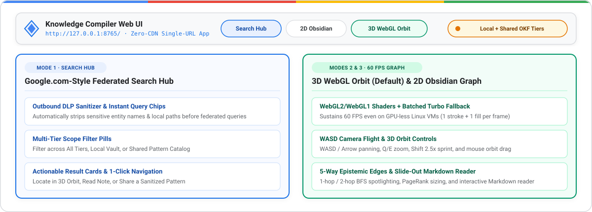

# Knowledge Compiler (`knowledge-compiler`)

[](https://github.com/GoogleCloudPlatform/knowledge-compiler/releases)
[](https://github.com/GoogleCloudPlatform/knowledge-compiler/actions/workflows/ci.yml)
[](https://github.com/open-knowledge-format/open-knowledge-format)
[](LICENSE)

> **Obsidian is the IDE. The Agent is the Maintenance Programmer. The Markdown Wiki is the Persistent Codebase.**

**Knowledge Compiler** is an open-source knowledge engineering plugin and CLI suite implementing the [Open Knowledge Format (`OKF v0.3`)](https://github.com/open-knowledge-format/open-knowledge-format) (with full `OKF v0.2` backward compatibility) and Andrej Karpathy's compiled LLM-Wiki architecture. It compiles unstructured documents (`.pptx`, `.pdf`, `.docx`, `.xlsx`, `.html`, `.mhtml`, transcripts, and codebases) into a schema-validated Markdown wiki (`raw/` → `wiki/` → `index.md` & `log.md`) with an interactive **2D/3D WebGL Knowledge Graph**, so coding agents start every project with curated, reviewable context.


---

## Quick Start (60-Second Walkthrough)

**Prerequisites**: Python `>= 3.10` (`>= 3.11` recommended) and Git.

```bash
git clone https://github.com/GoogleCloudPlatform/knowledge-compiler.git
cd knowledge-compiler
python3 -m pip install -e ".[extract]"
```

### 1. Explore the Included OKF v0.3 Starter Vault
The repository includes a clean-room Google Cloud starter vault in [`examples/starter-vault/`](examples/starter-vault/index.md) compiling 2 `raw/` briefs into **21 OKF v0.3 wiki notes** across `wiki/sources/` (2), `wiki/entities/` (5), `wiki/concepts/` (7, including `status: deprecated` + `superseded_by` and an `Attested Computation`), `wiki/patterns/` (4), and `wiki/synthesis/` (3), complete with standard **OKF v0.3 relative Markdown links**, frontmatter-free `wiki/index.md` & `wiki/*/index.md` progressive-disclosure indexes (§8), namespaced `x-kc-*` epistemic extension keys (§4.1), inline Mermaid diagrams, and GFM tables (verified `0 errors, 0 warnings, 0 info` under the official OKF v0.3 `validate.py --strict`):

```bash
# Audit strict OKF v0.3 conformance, relative Markdown links, [[wikilinks]], and footnotes
vault-lint examples/starter-vault --strict

# Query with zero-index-file BM25 ranking
vault-query "BigQuery partition pruning" --vault examples/starter-vault

# Launch the interactive 2D/3D WebGL Graph & inline Mermaid/table reader (http://127.0.0.1:8765)
vault-graph examples/starter-vault
```

### 2. Initialize or Upgrade Your Own Vault

```bash
# Scaffold a fresh OKF v0.3 Knowledge Vault (bundle root '.', compiled concepts in wiki/)
vault-init --target ~/ObsidianVault

# Extract a slide deck, PDF, or web page into raw/ (with SHA-256 caching)
vault-extract /path/to/architecture-deck.pptx --vault ~/ObsidianVault

# Upgrade an OKF v0.2 vault (index.md, log.md, bundle paths, x-kc-* keys, wiki/**/index.md)
vault-lint ~/ObsidianVault --fix --migrate-v03

# Optional: also convert Obsidian [[wikilinks]] to portable OKF v0.3 relative Markdown links
vault-lint ~/ObsidianVault --fix --migrate-v03 --portable-links

# Optional: install skills & opt-in lifecycle hooks for non-Marketplace setups
kc-install-plugin
vault-hooks enable
```



---

## Core Capabilities

<!-- mdformat off -->
| Capability | Command / Skill | Underlying Script |
| :--- | :--- | :--- |
| **Multimodal Source Ingestion** | `/ingest <target>` | `scripts/extract_source.py` |
| **Retrospective Session Distillation** | `/distill-session` | Native skill workflow |
| **Tri-State Fact Correction Sweep** | `/vault-correct "<fact>"` | `scripts/vault_correct.py` |
| **In-Memory BM25 Vault Query** | `/vault-query <query>` | `scripts/vault_query.py` |
| **Graph & Schema Auto-Linter** | `/vault-lint` | `scripts/vault_lint.py` |
| **2D/3D WebGL Knowledge Graph** | `/vault-graph` | `scripts/vault_graph.py` |
| **Sanitized Pattern Sharing** | `/vault-share` & `/vault-pull` | `scripts/sync_patterns.py` |
| **Strict DLP & Link Sanitizer** | `vault-sanitize-check` | `scripts/sanitize_check.py` |
| **Lifecycle Hook Manager** | `vault-hooks` | `scripts/vault_hooks.py` |
| **Closed-Loop Skill Evolution** | `/wikiskill` | `scripts/analyze_trace.py`, `scripts/wikiskill_eval.py` |
<!-- mdformat on -->

---

## Using with AI Coding Agents

<!-- mdformat off -->
| Environment | Setup | Included Surfaces |
| :--- | :--- | :--- |
| **Antigravity / Agent Plugin Hosts** | Native root `plugin.json`, `skills/`, `rules/`, `hooks.json`, and `sidecars/vault_graph` | All 10 slash-command skills, workspace rule, opt-in hooks, and WebGL Graph side pane |
| **Gemini CLI & `SKILL.md` Harnesses** | Run `python3 scripts/install_plugin.py` (or copy `skills/` and `rules/AGENTS.md`) | Portable `SKILL.md` bundles + `vault-*` console scripts |
| **Standalone CLI & CI Pipelines** | `python3 -m pip install -e ".[extract]"` | Deterministic `vault-lint --strict --json`, `vault-query`, `vault-correct`, and `vault-graph --export` |
<!-- mdformat on -->

---

## What This Plugin Installs

- **10 Agent Skills (`skills/*/SKILL.md`)**: `knowledge-compiler`, `ingest`, `distill-session`, `vault-correct`, `vault-query`, `vault-lint`, `vault-graph`, `vault-share`, `vault-pull`, and `wikiskill`.
- **1 Workspace Rule (`rules/AGENTS.md`)**: Progressive disclosure and OKF v0.3/v0.2 formatting guidelines.
- **3 Lifecycle Hooks (`hooks.json`, all opt-in / disabled by default)**:
  - `wikiskill-error-recorder` (`PostToolUse`, **disabled by default**): When enabled via `python3 -m scripts.vault_hooks enable --hooks wikiskill`, captures redacted local tool failure diagnostics to `$XDG_STATE_HOME/knowledge-compiler/logs/error_traces.jsonl` (`~/.local/state/knowledge-compiler/logs/error_traces.jsonl`) to power `/wikiskill`.
  - `vault-session-start` & `vault-stop-hook` (**disabled by default**): Optional Git pull/push synchronization hooks enabled in one command via `python3 -m scripts.vault_hooks enable` for users who explicitly opt in to backing their vault with a Git `origin` remote.
- **1 Interactive Sidecar (`sidecars/vault_graph`)**: Local loopback 2D/3D WebGL Knowledge Graph server (`127.0.0.1:8765`).
- **1 Clean-Room Starter Vault (`examples/starter-vault/`)**: Ready-to-run 21-note OKF v0.3 sample vault (`raw/` → `wiki/sources/`, `entities/`, `concepts/`, `patterns/`, `synthesis/`) with `status: deprecated` + `superseded_by`, `Attested Computation`, and inline Mermaid `flowchart`/`sequenceDiagram`/`pie` diagrams + GFM tables for testing `vault-lint`, `vault-query`, and `vault-graph`.

---

## Hooks & Local Data Privacy

- **100% Local Default Operation**: All compiled Markdown notes (`wiki/`, `index.md`, `log.md`), SHA-256 ingestion caches (`.ingest_cache.json`), and redacted error traces remain on your local filesystem.
- **Verifiable Offline Guarantee**: Run `python3 -m unittest tests.test_v1_release_gates.TestV1ReleaseGates.test_gate1_offline_plane1_socket_blocked` to independently verify that `vault-init`, `vault-lint`, `vault-query`, `vault-correct`, and `vault-graph` succeed with `socket.socket` monkeypatched to raise on any network call.
- **User-Initiated Network Calls Only**: Outbound HTTP requests occur only when you explicitly pass a web URL to `scripts/extract_source.py`, pass `--check-okf-upstream` to `scripts/vault_lint.py`, run `vault-sync-patterns share --open-pr`, or manually enable the opt-in Git `origin` sync hooks via `vault-hooks enable`.

---

## Troubleshooting, Contributing & Security

- **Troubleshooting**: Run `vault-lint --fix` to repair broken `[[wikilinks]]` or table pipe formatting, or `vault-lint --fix --migrate-v03` to upgrade an OKF v0.2 vault. If port `8765` is in use, pass `--port <PORT>` to `vault-graph`.
- **Stability & Compatibility**: See [STABILITY.md](STABILITY.md) for the frozen `1.x` CLI surface (`vault-*`), exit code (`0`/`1`/`2`), JSON output, and OKF v0.3 / v0.2 bundle root guarantees (`/wikiskill`, `vault-analyze-trace`, and `vault-wikiskill-eval` graduated to `Stable` in `v1.1.0` while preserving zero unattended instruction-file edits).
- **Contributing**: Pull requests are welcome! See [CONTRIBUTING.md](CONTRIBUTING.md) for CLA, testing, and Apache-2.0 header guidelines.
- **Feedback & Issues**: Report bugs or feature requests at [https://github.com/GoogleCloudPlatform/knowledge-compiler/issues](https://github.com/GoogleCloudPlatform/knowledge-compiler/issues).
- **Security**: See [SECURITY.md](SECURITY.md) for vulnerability reporting instructions (`https://g.co/vulnz`).

---

## Release History

### **v1.3.0** (`Latest`)
- **Full OKF v0.3 Interoperability (`vault-lint`, `vault-graph`, `vault-init`, `examples/starter-vault/`)**:
  - **Portable Standard Relative Markdown Links (`--portable-links`)**: First-class validation, orphan/index tracking, BM25 excerpt unwrapping, and clickable WebGL Reader navigation for standard RFC 3986 `%20`-encoded relative Markdown links (`[Label](../dir/Note%20Name.md)`) alongside full backward compatibility for Obsidian `[[wikilinks]]`. Adds deterministic `vault-lint --fix --portable-links` conversion and upgrades `examples/starter-vault/` (434+ inter-note Markdown links, 0 prose wikilinks) so generic OKF consumers (`okf-consume`, `viz.html`, GitHub, and Obsidian) all see the complete graph.
  - **Unambiguous OKF v0.3 Bundle Root (`.`) & Subdirectory Indexes (§8)**: Reports `"bundle_root": "."` and `"concepts_dir": "wiki"` in `vault-lint`, scaffolds frontmatter-free `wiki/index.md` on `vault-init`, and generates frontmatter-free `wiki/index.md` + `wiki/<subdir>/index.md` progressive-disclosure indexes in `examples/starter-vault/` and `--fix --migrate-v03`.
  - **OKF v0.3 §4.1 Namespaced `x-kc-*` Epistemic Extensions**: Adopts `x-kc-corroborates`, `x-kc-complements`, `x-kc-extends`, `x-kc-contradicts`, and `x-kc-supersedes` as canonical v0.3 frontmatter keys (migrated automatically by `--fix --migrate-v03` while remaining 100% backward-compatible with legacy unprefixed keys). `examples/starter-vault/` passes the official OKF v0.3 `validate.py --strict` with **0 errors, 0 warnings, and 0 info**.

### **v1.2.0**
- **Native Open Knowledge Format (`OKF v0.3`) Support with Full `v0.2` Backward Compatibility**: Upgrades `scripts/okf.py`, `scripts/init_vault.py`, `scripts/vault_lint.py`, `scripts/vault_graph.py`, `scripts/sync_patterns.py`, and `scripts/hooks/auto_sync_vault.py` to conform to the [OKF v0.3 specification](https://github.com/open-knowledge-format/open-knowledge-format):
  - **Root Bundle Metadata & Reserved Files (§8, §9)**: Fresh vaults emit `okf_version: "0.3"` with `title`/`description` in root `index.md` and frontmatter-free `log.md` using newest-first `## YYYY-MM-DD` date headings (with union merge support for both `v0.3` and legacy `v0.2` logs).
  - **Verification Currency & Fail-Closed Staleness (§5.3, §5.5, §11.2)**: `derive_trust_tier()` ignores verifications older than `generated.at` (`stale_verification_notes` tracked in `vault-lint --json`), unparseable `stale_after` fails closed as stale, and `parse_iso_datetime(..., require_offset=True)` enforces RFC 3339 offsets (date-only values map to UTC midnight).
  - **Path Resolution, `superseded_by` Edges, `team:` Actors & Attested Computation (§5.4, §6.2, §7, §10.2–§10.3)**: Supports relative vs leading-`/` bundle-root path resolution with automatic `v0.2` fallback, graphs `superseded_by` as `SUPERSEDES` edges, validates `team:` actors, `usage_window`/`usage_count`, and Attested Computation `parameters`/`executor`/`attester` + `# Computation` fence counts.
  - **One-Command Idempotent Migration (`vault-lint --fix --migrate-v03`)**: Deterministically upgrades existing `OKF v0.2` vaults (`index.md`, `log.md`, sub-`index.md`, and bare bundle-root path fields) to pass official OKF v0.3 validation with zero errors.
- **21-Note OKF v0.3 Starter Vault & First-Run Read-Only Sample Preview (`vault-graph`)**: Ships an expanded 26-file / 257-edge clean-room Google Cloud starter vault in `examples/starter-vault/` (lighting up all 7 node categories, all 6 epistemic edge types, 10 inline Mermaid diagrams, and 33 GFM tables), relative `.md` Markdown link graphing (`0` orphans on fresh `vault-init` vaults), a dismissible first-run welcome card, and a 1-click read-only `Sample Vault` / `My Vault` switcher in the WebGL visualizer.

### **v1.1.3**
- **Zero-CDN Inline SVG Mermaid & GFM Table Reader (`vault-graph`)**: Renders Mermaid `flowchart`/`graph` (nested subgraphs, sibling grids, labeled solid/dashed/thick/bidirectional edges), `sequenceDiagram`, and `pie` charts inline as CSP-safe SVG 1.1 with a full-screen lightbox (`Expand`) plus GFM Markdown tables inside the WebGL Reader drawer, alongside hardened desktop sidecar gateway and Linux VM forwarding.
- **Opt-In Lifecycle Hook Manager (`vault-hooks`) & Upgrade Preservation**: Adds `scripts/vault_hooks.py` (`status`, `enable`, `disable`) handling both writable plugin directories and read-only (`EROFS`) Marketplace mounts via non-colliding `kc-user-*` entries in user config, while `install_plugin.py` preserves existing `"enabled"` booleans across upgrades.
- **`/wikiskill` Graduated to `Stable` (`vault-wikiskill-eval` & `vault-analyze-trace --propose`)**: Adds deterministic offline Asymmetric Rollback Evaluation (`scripts/wikiskill_eval.py`) with SHA-256 CAS updates strictly limited to `wiki/skill-impact.md`, plus redacted out-of-vault proposal clustering (`0700`/`0600`) in `scripts/analyze_trace.py`.
- **Graph Intelligence (`vault-lint` & `vault-graph`)**: Adds synthesis drift detection (`stale_syntheses`, `--strict-drift`), plain-text unlinked mention scanning (`--mentions`), two-phase CAS entity/concept deduplication (`--dedup-manifest` / `--apply-manifest`), one-command isolated worktree pattern PRs (`vault-sync-patterns share --open-pr`), and lazy `/api/note` markdown loading in `vault_graph.py`.
- **Open Source Compliance CI Gate (`tests/test_oss_cross_compliance.py`)**: Enforces Apache-2.0 headers, UTF-8/LF endings, clean-room disclaimers, and zero secret/sensitive tokens on every CI run.

### **v1.0.0**
- **`1.x` Stability & Unified `vault-*` CLI Contract ([STABILITY.md](STABILITY.md))**: Freezes `wiki/` as the OKF v0.2 bundle root, standardizes `vault-init`, `vault-extract`, `vault-lint`, `vault-correct`, `vault-query`, `vault-graph`, `vault-sync-patterns`, `vault-sanitize-check`, and `kc-install-plugin` with deterministic exit codes (`0`/`1`/`2`).
- **Zero-Dependency In-Memory BM25 Retrieval & Incremental Graph Cache**: Adds `vault-query` (`scripts/vault_query.py`) with identifier splitting, CJK bigrams, duplicate check (`--check-duplicate`), and raw fence isolation (`--include-raw`), plus `(mtime_ns, ctime_ns, size)` incremental caching in `vault-graph`.
- **Pluggable Federation Architecture**: `FederationProvider` interface (`scripts/federation_provider.py`) supporting `LocalGitPatternProvider` for a Git-backed shared patterns repository.
- **Marketplace Native Packaging**: Top-level `plugin.json`, `hooks.json`, `skills/`, `rules/`, and `sidecars/vault_graph` ready for one-click installation.
- **Zero-Dependency OOXML Extraction**: Pure-Python stdlib XML/ZIP fallback extractors for `.pptx`, `.docx`, and `.xlsx` alongside `pypdf` and `python-pptx`.

---

## Disclaimer

This is not an officially supported Google product. Eligibility for the [Google Open Source Software Vulnerability Rewards Program](https://bughunters.google.com/open-source-security) is determined by the Google OSS VRP Rules.
