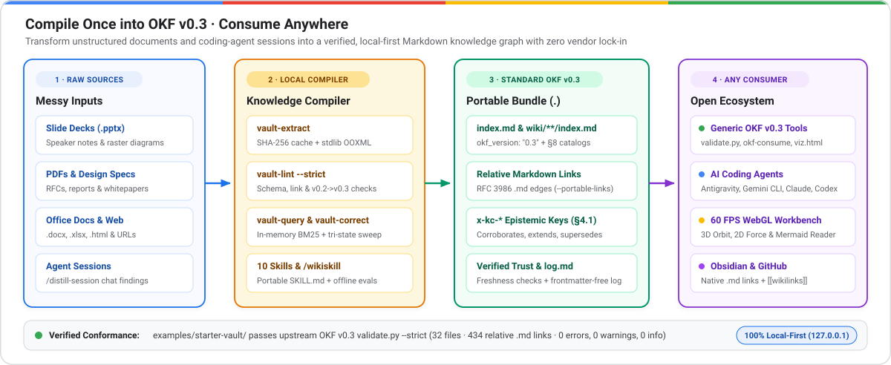
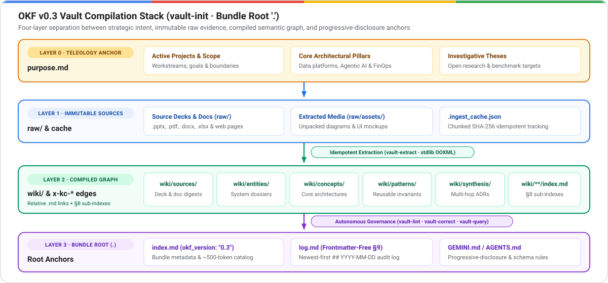

<div align="center">


<h1>Knowledge Compiler</h1>

<p>
  <strong>Give your AI coding agent persistent, inspectable memory saved across sessions.</strong><br />
  Turn slide decks, PDFs, Office docs, and long working sessions into a clean, local-first Markdown library (<a href="https://github.com/open-knowledge-format/open-knowledge-format">OKF v0.3</a>) with a built-in 60 FPS 3D WebGL graph viewer.
</p>

<p>
  <a href="https://googlecloudplatform.github.io/knowledge-compiler/"><strong>Live 3D Demo &#8599;</strong></a> &middot;
  <a href="https://github.com/GoogleCloudPlatform/knowledge-compiler/releases"><strong>v1.3.1</strong></a> &middot;
  <a href="https://github.com/GoogleCloudPlatform/knowledge-compiler/actions/workflows/ci.yml"><strong>CI</strong></a> &middot;
  <a href="https://github.com/open-knowledge-format/open-knowledge-format"><strong>OKF v0.3 Strict</strong></a> &middot;
  <a href="https://okf.md/tools/#knowledge-compiler"><strong>okf.md</strong></a> &middot;
  <a href="pyproject.toml"><strong>Python 3.10+</strong></a> &middot;
  <a href="LICENSE"><strong>Apache-2.0</strong></a>
</p>

<p>
  <a href="#how-it-helps-in-day-to-day-work">How It Works</a> &middot;
  <a href="#quick-start-60-second-walkthrough">60-Second Demo</a> &middot;
  <a href="#compile-once-consume-anywhere">OKF v0.3 Interoperability</a> &middot;
  <a href="#interactive-60-fps-webgl-workbench">WebGL Workbench</a> &middot;
  <a href="#10-portable-agent-skills-and-cli">Skills &amp; CLI</a> &middot;
  <a href="#local-first-privacy-and-offline-proof">Offline Proof</a>
</p>

</div>

<br />



---

## How It Helps in Day-to-Day Work

If you work with AI assistants on complex projects, you have probably hit the same walls: uploading 100-slide decks and PDFs into chat quickly hits context limits, details inside tables and diagrams get lost in chunking, and lessons you spent hours figuring out disappear the moment you open a new conversation.

**Knowledge Compiler** fixes that by giving your AI agent a structured, local Markdown memory that compounds from session to session:

- **Turn messy files and sessions into lasting memory**: Drop in slide decks, PDFs, Office docs, web pages, or notes from a working session. It compiles them into an organized library of linked Markdown notes right on your machine, so your AI assistant still knows your project context weeks later without re-uploading a single slide.
- **Solve hard problems once and reuse them**: Capture what worked during a deep dive or architecture review, automatically scrub private details, and share clean, reusable playbooks with your team.
- **Keep facts accurate without rewriting history**: When a requirement, target, or design changes mid-project, update the current truth across your notes while leaving original meeting notes and historical records completely untouched.
- **Stay 100% local and portable**: Everything stays on your computer in plain UTF-8 Markdown files built on Google Cloud's open [**Open Knowledge Format (`OKF v0.3`)**](https://github.com/open-knowledge-format/open-knowledge-format) with zero cloud backend or lock-in. It works out of the box across Antigravity, Gemini CLI, Claude Code, Codex, Cursor, GitHub, and Obsidian, and includes an interactive 3D graph viewer to explore how all your ideas connect.

---

## Quick Start (60-Second Walkthrough)

**Prerequisites**: Python `>= 3.10` (`>= 3.11` recommended) and Git on Windows, macOS, or Linux. Zero cloud accounts or API keys required.

```bash
git clone https://github.com/GoogleCloudPlatform/knowledge-compiler.git
cd knowledge-compiler
python3 -m pip install -e ".[extract]"
```

### 1. Explore the Included 21-Note OKF v0.3 Starter Vault

The repository ships a clean-room Google Cloud architecture vault in [`examples/starter-vault/`](examples/starter-vault/index.md) (`32` total Markdown files, `434` standard inter-note relative Markdown links, `0` prose wikilinks, `57` `x-kc-*` epistemic edges, `10` inline Mermaid diagrams, `33` GFM tables, a deprecated concept with `superseded_by`, and an `Attested Computation`):

```bash
# Audit strict OKF v0.3 conformance, relative Markdown links, [[wikilinks]], and footnotes
vault-lint examples/starter-vault --strict

# Query with zero-index-file Okapi BM25 ranking (no .sqlite files created)
vault-query "BigQuery partition pruning" --vault examples/starter-vault

# Launch the 60 FPS 2D/3D WebGL Workbench & inline Mermaid/table Reader (http://127.0.0.1:8765)
vault-graph examples/starter-vault
```

### 2. Initialize or Upgrade Your Own Knowledge Vault

```bash
# Scaffold a fresh OKF v0.3 vault (bundle root '.', compiled concepts in wiki/)
vault-init --target ~/KnowledgeVault

# Extract a slide deck, PDF, Office doc, or web page into raw/ (with SHA-256 caching)
vault-extract /path/to/architecture-deck.pptx --vault ~/KnowledgeVault

# Upgrade an existing OKF v0.2 vault (index.md, log.md, bundle paths, x-kc-* keys, wiki/**/index.md)
vault-lint ~/KnowledgeVault --fix --migrate-v03

# Optional: convert legacy Obsidian [[wikilinks]] into portable OKF v0.3 relative Markdown links
vault-lint ~/KnowledgeVault --fix --migrate-v03 --portable-links

# Optional: install portable skills & enable opt-in Git sync hooks for non-Marketplace setups
kc-install-plugin
vault-hooks enable
```

---

## Compile Once, Consume Anywhere

Under the hood, **Knowledge Compiler** implements Google Cloud's [**Open Knowledge Format (`OKF v0.3`)**](https://github.com/open-knowledge-format/open-knowledge-format) (with full `OKF v0.2` backward compatibility) and Andrej Karpathy's compiled LLM-Wiki pattern. Agents scan a `~500`-token root `index.md` and follow 1-hop / 2-hop links instead of saturating context windows, preserving Markdown tables, inline Mermaid diagrams, footnote citations, verification freshness (`verified[].at >= generated.at`), and deprecation chains (`status: deprecated` + `superseded_by`), while passing upstream `open-knowledge-format` `validate.py --strict` with **`0 errors, 0 warnings, 0 info`**:

<!-- mdformat off -->
| Consumer | What Works Out of the Box |
| :--- | :--- |
| **Generic OKF v0.3 Consumers** (`validate.py`, `okf-consume`, `viz.html`, CI) | Sees the complete link graph (`bundle_root: "."`, RFC 3986 relative `.md` links, frontmatter-free `wiki/**/index.md` catalogs, `x-kc-*` §4.1 extensions, and fail-closed staleness). |
| **AI Coding Agents** (Antigravity, Gemini CLI, Claude Code, Codex, Cursor) | Native root `plugin.json` + **10 portable `SKILL.md` workflows** + `rules/AGENTS.md` progressive-disclosure guidelines. |
| **Built-In 60 FPS WebGL Workbench** (`vault-graph`, `127.0.0.1:8765`) | Zero-CDN 3D Orbit & 2D Force graph, `WASD` camera flight, inline SVG Mermaid & GFM table Reader, in-memory BM25 Search Hub, and 1-click standalone HTML export. |
| **Obsidian & GitHub** | Every inter-note link clicks straight through natively on GitHub and inside Obsidian, while remaining 100% backward-compatible with Obsidian `[[wikilinks]]` and OKF v0.2 vaults. |
<!-- mdformat on -->

---

## Interactive 60 FPS WebGL Workbench

`vault-graph` launches a **zero-CDN, loopback-only (`127.0.0.1:8765`)** workbench designed to stay smooth at 60 FPS even on GPU-less Linux VMs and remote desktops:



- **3D WebGL Orbit & 2D Force Views**: Hardware-accelerated WebGL2/WebGL1 shaders with a single-pass Batched Turbo 2D fallback, `WASD` + `Shift` sprint flight, PageRank node sizing, and 1-hop / 2-hop BFS spotlighting.
- **Split-Pane OKF v0.3 Reader**: Renders inline CSP-safe SVG Mermaid diagrams (`flowchart`/`graph`, `sequenceDiagram`, `pie`) with full-screen lightbox (`Expand`), formatted GFM tables, YAML trust metadata, and clickable relative `.md` link navigation.
- **First-Run Sample Preview & Offline Export**: Switch between your own vault and the built-in 21-note read-only `Sample Vault` in one click, or emit a single self-contained HTML artifact with `vault-graph --export`.

<details>
<summary><strong>View Search Hub &amp; Multi-Mode Web UI Architecture</strong></summary>
<br />


</details>

---

## 4-Layer OKF v0.3 Vault Architecture

Every compiled vault maintains a strict separation between immutable raw evidence (`raw/`), compiled semantic notes (`wiki/`), and progressive-disclosure root anchors (`.`):



---

## 10 Portable Agent Skills and CLI

Use **Knowledge Compiler** through slash commands inside your AI coding agent or directly from the terminal and CI pipelines:

<!-- mdformat off -->
| Capability | Agent Skill | CLI Command | What It Does |
| :--- | :--- | :--- | :--- |
| **Multimodal Ingestion** | `/ingest` | `vault-extract` | Unpacks `.pptx`, `.pdf`, `.docx`, `.xlsx`, `.html`, `.mhtml`, and URLs into `raw/` with SHA-256 caching and a pure-stdlib OOXML fallback. |
| **Session Distillation** | `/distill-session` | Agent workflow | Retrospectively compiles newly discovered architecture decisions, entities, and bug fixes from your chat trajectory into OKF notes. |
| **In-Memory BM25 Search** | `/vault-query` | `vault-query` | Multi-field Okapi BM25 ranking across titles, tags, headings, and prose with duplicate detection (`--check-duplicate`) and zero index files. |
| **Strict OKF Linting** | `/vault-lint` | `vault-lint` | Validates OKF v0.3 / v0.2 schemas, relative `.md` links, `[[wikilinks]]`, footnotes, drift (`--strict-drift`), v0.3 migration, and `--portable-links`. |
| **Tri-State Fact Sweep** | `/vault-correct` | `vault-correct` | Safe plan-and-apply sweep that updates the canonical note, refactors living restatements into links, and preserves historical sources untouched. |
| **60 FPS WebGL Graph** | `/vault-graph` | `vault-graph` | Serves the local 3D Orbit / 2D Force visualizer, inline Mermaid/table Reader, and Search Hub (`127.0.0.1:8765`), or exports standalone HTML. |
| **Sanitized Sharing** | `/vault-share` & `/vault-pull` | `vault-sync-patterns` | Strips private entities and local paths before sharing reusable concepts to a team Git patterns repository (`--open-pr`) and pulls upstream updates safely. |
| **DLP & Link Gate** | *(CLI / CI)* | `vault-sanitize-check` | Fail-closed scanner verifying zero leaked private identifiers, local paths, or broken links across shared pattern repositories. |
| **Closed-Loop Skill Evals** | `/wikiskill` | `vault-analyze-trace`, `vault-wikiskill-eval` | Clusters redacted local tool-error traces and gates candidate `SKILL.md` refinements with deterministic offline Asymmetric Rollback evaluation. |
| **Lifecycle Hook Manager** | *(CLI)* | `vault-hooks` | Inspects, enables, or disables the 3 opt-in hooks cleanly across both writable installs and read-only Marketplace mounts. |
<!-- mdformat on -->

### Using with AI Coding Agents and CI

<!-- mdformat off -->
| Environment | Setup | Included Surfaces |
| :--- | :--- | :--- |
| **Antigravity & Agent Plugin Hosts** | Native root `plugin.json`, `skills/`, `rules/`, `hooks.json`, and `sidecars/vault_graph` | All 10 slash-command skills, workspace rule, opt-in hooks, and WebGL Graph side pane |
| **Gemini CLI & `SKILL.md` Harnesses** | Run `kc-install-plugin` (or copy `skills/` and `rules/AGENTS.md`) | Portable `SKILL.md` bundles + `vault-*` console scripts |
| **Standalone CLI & CI Pipelines** | `python3 -m pip install -e ".[extract]"` | Deterministic `vault-lint --strict --json`, `vault-query`, `vault-correct`, and `vault-graph --export` |
<!-- mdformat on -->

---

## Local-First Privacy and Offline Proof

- **100% Local Default Operation**: All Markdown notes (`wiki/`, `index.md`, `log.md`), SHA-256 caches (`.ingest_cache.json`), and local WebGL views stay strictly on your filesystem and `127.0.0.1`.
- **Independently Verifiable Offline Test**: Don't take our word for it. Run the bundled socket-blocking release gate, which monkeypatches `socket.socket` to raise on any network attempt across `vault-init`, `vault-lint`, `vault-query`, `vault-correct`, and `vault-graph`:
  ```bash
  python3 -m unittest tests.test_v1_release_gates.TestV1ReleaseGates.test_gate1_offline_plane1_socket_blocked
  ```
- **Explicit User-Initiated Network Calls Only**: Outbound requests happen only when you explicitly pass an HTTP(S) URL to `vault-extract`, run `vault-lint --check-okf-upstream`, run `vault-sync-patterns share --open-pr`, or opt in to Git `origin` sync hooks via `vault-hooks enable`.

<details>
<summary><strong>What This Plugin Installs &amp; Opt-In Lifecycle Hooks (All Disabled by Default)</strong></summary>
<br />

- **10 Agent Skills (`skills/*/SKILL.md`)**: `knowledge-compiler`, `ingest`, `distill-session`, `vault-correct`, `vault-query`, `vault-lint`, `vault-graph`, `vault-share`, `vault-pull`, and `wikiskill`.
- **1 Workspace Rule (`rules/AGENTS.md`)**: Progressive disclosure and OKF v0.3 / v0.2 formatting guidelines.
- **3 Lifecycle Hooks (`hooks.json`, all opt-in / disabled by default)**:
  - `wikiskill-error-recorder` (`PostToolUse`, **disabled by default**): Enable via `vault-hooks enable --hooks wikiskill` to capture redacted local tool failure diagnostics in `$XDG_STATE_HOME/knowledge-compiler/logs/error_traces.jsonl` (`~/.local/state/knowledge-compiler/logs/error_traces.jsonl`).
  - `vault-session-start` & `vault-stop-hook` (**disabled by default**): Enable via `vault-hooks enable` for users who explicitly back their vault with a Git `origin` remote (with OKF-aware union rebasing for `log.md` and `index.md`).
- **1 Interactive Sidecar (`sidecars/vault_graph`)**: Local loopback 2D/3D WebGL Knowledge Graph server (`127.0.0.1:8765`).
- **1 Clean-Room Starter Vault (`examples/starter-vault/`)**: 21-note / 32-file OKF v0.3 reference bundle passing official `validate.py --strict` with zero errors.

</details>

---

## Stability, Troubleshooting, Contributing and Security

- **Troubleshooting**: Run `vault-lint --fix` to repair broken links or escaped table pipes, `vault-lint --fix --migrate-v03` to upgrade an OKF v0.2 vault, or `vault-lint --fix --portable-links` to convert Obsidian `[[wikilinks]]` to standard OKF relative Markdown links. If port `8765` is busy, pass `--port <PORT>` to `vault-graph`.
- **Stability & Compatibility**: See [STABILITY.md](STABILITY.md) for the frozen `1.x` CLI surface (`vault-*`), deterministic exit codes (`0`/`1`/`2`), JSON contract, and OKF v0.3 / v0.2 guarantees.
- **Contributing**: Pull requests are welcome! See [CONTRIBUTING.md](CONTRIBUTING.md) for CLA, testing (`python3 -m unittest discover -s tests -p "test_*.py" -v`), and Apache-2.0 header guidelines.
- **Feedback & Issues**: Report bugs or request features at [https://github.com/GoogleCloudPlatform/knowledge-compiler/issues](https://github.com/GoogleCloudPlatform/knowledge-compiler/issues).
- **Security**: See [SECURITY.md](SECURITY.md) for vulnerability reporting instructions (`https://g.co/vulnz`).

---

## Release History

### **v1.3.1** (`Latest`)
- **Full OKF v0.3 Interoperability (`vault-lint`, `vault-graph`, `vault-init`, `examples/starter-vault/`)**:
  - **Portable Standard Relative Markdown Links (`--portable-links`)**: First-class validation, orphan/index tracking, BM25 excerpt unwrapping, and clickable WebGL Reader navigation for standard RFC 3986 `%20`-encoded relative Markdown links (`[Label](../dir/Note%20Name.md)`) alongside full backward compatibility for Obsidian `[[wikilinks]]`. Adds deterministic `vault-lint --fix --portable-links` conversion and upgrades `examples/starter-vault/` (434 inter-note Markdown links, 0 prose wikilinks) so generic OKF consumers (`okf-consume`, `viz.html`, GitHub, and Obsidian) all see the complete graph.
  - **Unambiguous OKF v0.3 Bundle Root (`.`) & Subdirectory Indexes (§8)**: Reports `"bundle_root": "."` and `"concepts_dir": "wiki"` in `vault-lint`, scaffolds frontmatter-free `wiki/index.md` on `vault-init`, and generates frontmatter-free `wiki/index.md` + `wiki/<subdir>/index.md` progressive-disclosure indexes in `examples/starter-vault/` and `--fix --migrate-v03`.
  - **OKF v0.3 §4.1 Namespaced `x-kc-*` Epistemic Extensions**: Adopts `x-kc-corroborates`, `x-kc-complements`, `x-kc-extends`, `x-kc-contradicts`, and `x-kc-supersedes` as canonical v0.3 frontmatter keys (migrated automatically by `--fix --migrate-v03` while remaining 100% backward-compatible with legacy unprefixed keys). `examples/starter-vault/` passes the official OKF v0.3 `validate.py --strict` with **0 errors, 0 warnings, and 0 info**.

<details>
<summary><strong>Previous Releases (v1.2.0 &ndash; v1.0.0)</strong></summary>

### **v1.2.0**
- **Native Open Knowledge Format (`OKF v0.3`) Support with Full `v0.2` Backward Compatibility**: Upgrades `scripts/okf.py`, `scripts/init_vault.py`, `scripts/vault_lint.py`, `scripts/vault_graph.py`, `scripts/sync_patterns.py`, and `scripts/hooks/auto_sync_vault.py` to conform to the [OKF v0.3 specification](https://github.com/open-knowledge-format/open-knowledge-format):
  - **Root Bundle Metadata & Reserved Files (§8, §9)**: Fresh vaults emit `okf_version: "0.3"` with `title`/`description` in root `index.md` and frontmatter-free `log.md` using newest-first `## YYYY-MM-DD` date headings (with union merge support for both `v0.3` and legacy `v0.2` logs).
  - **Verification Currency & Fail-Closed Staleness (§5.3, §5.5, §11.2)**: `derive_trust_tier()` ignores verifications older than `generated.at` (`stale_verification_notes` tracked in `vault-lint --json`), unparseable `stale_after` fails closed as stale, and `parse_iso_datetime(..., require_offset=True)` enforces RFC 3339 offsets (date-only values map to UTC midnight).
  - **Path Resolution, `superseded_by` Edges, `team:` Actors & Attested Computation (§5.4, §6.2, §7, §10.2–§10.3)**: Supports relative vs leading-`/` bundle-root path resolution with automatic `v0.2` fallback, graphs `superseded_by` as `SUPERSEDES` edges, validates `team:` actors, `usage_window`/`usage_count`, and Attested Computation `parameters`/`executor`/`attester` + `# Computation` fence counts.
  - **One-Command Idempotent Migration (`vault-lint --fix --migrate-v03`)**: Deterministically upgrades existing `OKF v0.2` vaults (`index.md`, `log.md`, sub-`index.md`, and bare bundle-root path fields) to pass official OKF v0.3 validation with zero errors.
- **21-Note OKF v0.3 Starter Vault & First-Run Read-Only Sample Preview (`vault-graph`)**: Ships a clean-room Google Cloud starter vault in `examples/starter-vault/` (lighting up all 7 node categories, all 6 epistemic edge types, 10 inline Mermaid diagrams, and 33 GFM tables), relative `.md` Markdown link graphing (`0` orphans on fresh `vault-init` vaults), a dismissible first-run welcome card, and a 1-click read-only `Sample Vault` / `My Vault` switcher in the WebGL visualizer.

### **v1.1.3**
- **Zero-CDN Inline SVG Mermaid & GFM Table Reader (`vault-graph`)**: Renders Mermaid `flowchart`/`graph` (nested subgraphs, sibling grids, labeled solid/dashed/thick/bidirectional edges), `sequenceDiagram`, and `pie` charts inline as CSP-safe SVG 1.1 with a full-screen lightbox (`Expand`) plus GFM Markdown tables inside the WebGL Reader drawer, alongside hardened desktop sidecar gateway and Linux VM forwarding.
- **Opt-In Lifecycle Hook Manager (`vault-hooks`) & Upgrade Preservation**: Adds `scripts/vault_hooks.py` (`status`, `enable`, `disable`) handling both writable plugin directories and read-only (`EROFS`) Marketplace mounts via non-colliding `kc-user-*` entries in user config, while `install_plugin.py` preserves existing `"enabled"` booleans across upgrades.
- **`/wikiskill` Graduated to `Stable` (`vault-wikiskill-eval` & `vault-analyze-trace --propose`)**: Adds deterministic offline Asymmetric Rollback Evaluation (`scripts/wikiskill_eval.py`) with SHA-256 CAS updates strictly limited to `wiki/skill-impact.md`, plus redacted out-of-vault proposal clustering (`0700`/`0600`) in `scripts/analyze_trace.py`.
- **Graph Intelligence (`vault-lint` & `vault-graph`)**: Adds synthesis drift detection (`stale_syntheses`, `--strict-drift`), plain-text unlinked mention scanning (`--mentions`), two-phase CAS entity/concept deduplication (`--dedup-manifest` / `--apply-manifest`), one-command isolated worktree pattern PRs (`vault-sync-patterns share --open-pr`), and lazy `/api/note` markdown loading in `vault_graph.py`.
- **Open Source Compliance CI Gate (`tests/test_oss_cross_compliance.py`)**: Enforces Apache-2.0 headers, UTF-8/LF endings, clean-room disclaimers, and zero secret/sensitive tokens on every CI run.

### **v1.0.0**
- **`1.x` Stability & Unified `vault-*` CLI Contract ([STABILITY.md](STABILITY.md))**: Standardizes `vault-init`, `vault-extract`, `vault-lint`, `vault-correct`, `vault-query`, `vault-graph`, `vault-sync-patterns`, `vault-sanitize-check`, and `kc-install-plugin` with deterministic exit codes (`0`/`1`/`2`).
- **Zero-Dependency In-Memory BM25 Retrieval & Incremental Graph Cache**: Adds `vault-query` (`scripts/vault_query.py`) with identifier splitting, CJK bigrams, duplicate check (`--check-duplicate`), and raw fence isolation (`--include-raw`), plus `(mtime_ns, ctime_ns, size)` incremental caching in `vault-graph`.
- **Pluggable Federation Architecture**: `FederationProvider` interface (`scripts/federation_provider.py`) supporting `LocalGitPatternProvider` for a Git-backed shared patterns repository.
- **Marketplace Native Packaging**: Top-level `plugin.json`, `hooks.json`, `skills/`, `rules/`, and `sidecars/vault_graph` ready for one-click installation.
- **Zero-Dependency OOXML Extraction**: Pure-Python stdlib XML/ZIP fallback extractors for `.pptx`, `.docx`, and `.xlsx` alongside `pypdf` and `python-pptx`.

</details>

---

## Disclaimer

This is not an officially supported Google product. Eligibility for the [Google Open Source Software Vulnerability Rewards Program](https://bughunters.google.com/open-source-security) is determined by the Google OSS VRP Rules.
