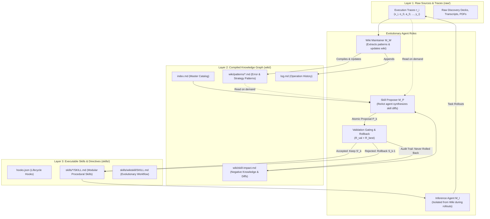

# 🧠 WikiSkill Framework Specification

> **Reference**: Tang, L., Rashtchian, C., Ferng, C.-S., Tomkins, A., Juan, D.-C., & Vu, T. (2026). *WikiSkill: Compiling Agent Experience into Persistent Knowledge for Skill Evolution*. Google Research & Virginia Tech.  
> **arXiv**: [arXiv:2608.27454](https://arxiv.org/html/2608.27454v1)

---

## 📌 Overview & Core Thesis

Autonomous agents operating in complex environments (cloud engineering, code refactoring, infrastructure debugging) accumulate vast histories of execution trials. Existing agent self-improvement methods (e.g. EvoSkill, Trace2Skill, SkillOpt) collapse three distinct concepts into one:
1. **Raw execution traces**
2. **Accumulated diagnostic knowledge**
3. **Active executable skills**

As an agent interacts with environments over time, it accumulates an uncurated, ever-expanding history of trials, making it prone to repeating failed interventions and suffering context exhaustion during skill synthesis.

**WikiSkill** resolves this bottleneck by adopting Andrej Karpathy's compiled **LLM-Wiki paradigm**:
- **Obsidian is the IDE**
- **The LLM is the maintenance programmer**
- **Structured Markdown is the persistent codebase**

---

## 🏛️ 3-Layer Separation of Concerns

### Layer Definitions:
1. **Layer 1: Raw Layer (`raw/`)**:
   Append-only, immutable repository of execution traces, terminal outputs, error stacks, customer slide decks, and meeting transcripts.
2. **Layer 2: Persistent Wiki Layer (`wiki/`, `index.md`, `log.md`)**:
   A living, structured Markdown knowledge base maintained by an autonomous LLM compiler. Contains distilled concepts, entity dossiers, error diagnostic patterns, and the `skill-impact.md` audit ledger.
3. **Layer 3: Executable Directives Layer (`skills/`, `GEMINI.md`)**:
   Compact, modular procedural instructions injected into the inference agent's runtime context.

---

## 🔄 The Closed-Loop Evolution Cycle

### 1. Passive Telemetry Capture (`PostToolUse` Hook)
Antigravity executes commands and tools during normal engineering workflows. If any command fails (`status == "ERROR"` or non-zero exit code), the `hooks.json` lifecycle hook triggers `scripts/hooks/log_tool_failure.py`. The failure payload is captured from `stdin` and appended to `error_traces.jsonl` with **zero manual toil**.

### 2. Failure Diagnosis & Pattern Mining (`analyze_trace.py`)
The Wiki Maintainer reads the raw execution traces, isolates root-cause failure modes (e.g., API schema mismatches, missing authentication headers, improper file formats), and compiles them into persistent patterns (`wiki/patterns/`).

### 3. ReAct Skill Proposal (`/wikiskill`)
The Skill Proposer operates as a multi-turn ReAct agent. It reads:
- The target skill's `SKILL.md`
- Relevant error patterns from `wiki/patterns/`
- Prior rejected attempts from `wiki/skill-impact.md`

It formulates an atomic mutation (unified diff) to the skill instructions designed to prevent future occurrences of the failure.

### 4. Validation Gating & Asymmetric Rollback
The candidate modification is evaluated against a hermetic validation test suite:
- **If validation passes ($R_{\text{val}} > R_{\text{best}}$)**: The updated `SKILL.md` is committed to the active skill set, and the victory is logged.
- **If validation fails ($R_{\text{val}} \le R_{\text{best}}$)**: The code/prompt changes are immediately reverted via `git checkout`. **However, the diagnostic analysis and reason for rejection are permanently committed to `wiki/skill-impact.md`.**

> [!IMPORTANT]
> **The Asymmetric Rollback Invariant**:  
> In WikiSkill, executable code and prompts roll back upon failure, but **the wiki is never rolled back**. This preserves an auditable negative-knowledge frontier that prevents future agents from getting trapped in cyclical trial-and-error loops.

---

## 🚀 Implementation in `knowledge-compiler`

The `knowledge-compiler` repository provides a turn-key implementation of the WikiSkill framework for engineering teams and Antigravity agents:

<!-- mdformat off -->
| WikiSkill Component | Repository Implementation |
| :--- | :--- |
| **Lifecycle Hook** | `hooks.json` & `scripts/hooks/log_tool_failure.py` |
| **Trace Analyzer** | `scripts/analyze_trace.py` |
| **Evolution Workflow** | `skills/wikiskill/SKILL.md` |
| **Negative Knowledge Ledger** | `wiki/skill-impact.md` |
| **Rollback Protocol** | `skills/wikiskill/references/rollback_protocol.md` |
| **Offline Test Suite** | `tests/test_compiler_suite.py` |
<!-- mdformat on -->
