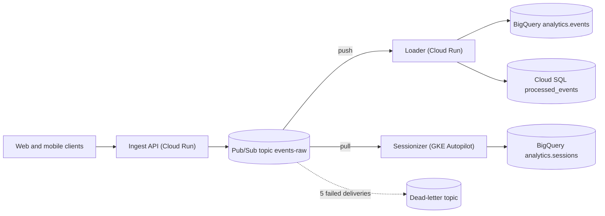

# Event Analytics Platform Design Brief

> Illustrative sample source for the starter vault. The platform, the team names, and every figure are fictional. They exist only to give the compiled wiki notes something concrete to cite.

| Field | Value |
| :--- | :--- |
| Document type | Design brief, pre-implementation |
| Authoring team | Cloud platform team |
| Review state | Accepted for build |
| Scope | Ingestion, delivery, enrichment, and analytical storage for product events |

## 1. Context

Product teams emit page-view, cart, and order events from web and mobile clients. Today a nightly batch job copies those events into the warehouse, so dashboards run a day behind and each load appends to one large unpartitioned table. Analysts filter almost every query by date and tenant, yet each query reads the whole table.

This brief proposes a streaming path that makes an event queryable within a minute of arrival, and a storage layout where the data a query reads is proportional to the time range it asks for.

## 2. Goals

| ID | Goal | Target |
| :--- | :--- | :--- |
| G1 | Freshness | 95th percentile under 60 seconds from an accepted HTTP request to a queryable row |
| G2 | Durability | No event lost once the ingest API has returned a success status |
| G3 | Burst tolerance | Sustain 5,000 events per second and absorb 10x bursts lasting up to 15 minutes |
| G4 | Bounded duplicates | At-least-once delivery end to end, with duplicates removable by `event_id` |
| G5 | Keyless identity | No exported service account keys anywhere on the path |
| G6 | Traceability | One trace from the client request through to the warehouse write |

Non-goals: sub-second analytics, multi-region active-active serving, and replacing the transactional order database.

## 3. Proposed Architecture

### 3.1 Ingest API on Cloud Run

A stateless HTTP service, `events-ingest`, validates each payload against the registered event schema, assigns an `event_id` when the client did not send one, and publishes the message to the `events-raw` topic. It returns a success status only after Pub/Sub has acknowledged the publish call. That ordering is what makes G2 hold. Pub/Sub decouples the service that produces a message from the services that process it,[^pubsub-overview] so once a publish is acknowledged the event no longer depends on the ingest instance staying alive.

The service scales on request concurrency. Two instances stay warm during business hours to keep cold starts out of the freshness target, and the service scales to zero overnight.

### 3.2 Delivery through Pub/Sub

One topic feeds two subscriptions:

- `loader-push` is a push subscription. Pub/Sub delivers each message as an HTTP request to the loader and authenticates that request, so the loader can stay private and reject unauthenticated traffic.[^run-pubsub-tutorial]
- `sessionizer-pull` is a pull subscription with message ordering enabled. The ingest API sets the ordering key to the session ID so that the events of one session arrive in the order they were published.[^pubsub-ordering]

Both subscriptions forward a message to the `events-dead-letter` topic after five failed delivery attempts, so a single malformed event can neither block the stream nor retry forever.[^pubsub-dead-letter] A separate subscription on the dead-letter topic keeps those messages for inspection and replay.

### 3.3 Loader on Cloud Run

The loader converts each pushed message into a row and appends it to `analytics.events` through the BigQuery Storage Write API. It answers with a success status only after the append succeeds. Any other response makes Pub/Sub deliver the message again.

Because delivery is at-least-once, the loader treats `event_id` as an idempotency key and keeps a `processed_events` ledger in Cloud SQL for PostgreSQL with a primary key on `event_id`. For every delivery it:

1. Looks up the `event_id` in the ledger. If the ID is present, it acknowledges the message and stops.
2. Appends the row to BigQuery.
3. Inserts the `event_id` into the ledger.
4. Returns a success status, which acknowledges the message.

A crash between steps 2 and 3 can still produce a duplicate row. The team accepts that window. Consumers that need exact counts read through a view that keeps one row per `event_id`.

### 3.4 Sessionizer on GKE Autopilot

The sessionizer groups events into sessions that close after 30 minutes of inactivity and writes one row per closed session to `analytics.sessions`. It holds open sessions in memory, keeps a long-lived streaming pull connection, and scales on subscription backlog instead of HTTP request rate. Those three properties fit a Kubernetes Deployment better than a request-driven service, so it runs on a GKE Autopilot cluster.

### 3.5 Analytical Storage in BigQuery

`analytics.events` is partitioned by day on `event_ts` and clustered by `tenant_id`, then `event_type`. Queries must filter on the partitioning column, and partitions expire after 400 days. A query that filters on a date range then reads only the matching partitions and skips the rest of the table.[^bq-partitioned-tables]

### 3.6 Identity

Every service runs as its own service account and holds only the roles it needs. The ingest API can publish to one topic. The loader can append to one dataset and connect to one database. No service account keys are created:

- Cloud Run services use the service identity attached to the service.
- Pods on GKE use Workload Identity Federation for GKE.
- The loader signs in to PostgreSQL with IAM database authentication.
- The deployment pipeline exchanges its own OIDC token for short-lived Google Cloud credentials through Workload Identity Federation.[^iam-wif]

### 3.7 Rollout

Each Cloud Run deployment creates a new revision that receives no traffic at first. Traffic then moves in four steps (5, 25, 50, and 100 percent) with a 15-minute hold at each step. If the error rate or the 95th percentile latency of the new revision breaches its objective during a hold, all traffic returns to the previous revision.[^run-rollouts]

### 3.8 Observability

All three services are instrumented with OpenTelemetry and export spans to Cloud Trace. The ingest API starts a trace for every request and copies the W3C trace context into the Pub/Sub message attributes. The loader and the sessionizer continue that trace when they process the message, so a single trace shows the HTTP request, the publish, the delivery, and the warehouse write.

## 4. Runtime Decision

| Component | Runtime | Deciding factors |
| :--- | :--- | :--- |
| Ingest API | Cloud Run | Stateless, request-driven, bursty, benefits from scaling to zero |
| Loader | Cloud Run | Stateless, one push request per message, scales with delivery rate |
| Sessionizer | GKE Autopilot | In-memory state, streaming pull, backlog-based autoscaling |

The rule the team adopted: start on Cloud Run, and move a component to GKE Autopilot only when it needs something Cloud Run does not offer for that workload shape.

## 5. Risks and Open Questions

1. **Connection pressure on PostgreSQL.** A burst can add many loader instances at once, and each one holds database connections. The loader caps its maximum instance count and uses a small connection pool per instance.
2. **Hot ordering keys.** Publish throughput per ordering key is limited, so one runaway session could lag behind. Session IDs should spread load evenly, but this needs a load test.
3. **Exactly-once delivery.** Pub/Sub offers exactly-once delivery on pull subscriptions. The team will evaluate whether enabling it for the sessionizer removes the need for application-level deduplication there.
4. **BigQuery subscription.** A subscription that writes straight to a BigQuery table could replace the loader for the raw table. It was set aside for now because the loader also validates and reshapes payloads.
5. **Cloud Run worker pools.** Cloud Run also has a worker pool resource type for pull-based background work.[^run-overview] It was not evaluated for this brief. If it meets the sessionizer's state and scaling needs, the runtime decision in section 4 should be revisited.
