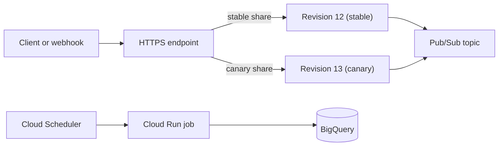

# Cloud Run Serverless Containers

[Cloud Run](../entities/Cloud%20Run.md) runs a container image in one of two shapes. A **service** answers HTTP, gRPC, WebSocket, and event-push requests on a managed HTTPS endpoint. A **job** runs one or more tasks to completion and then exits. Google Cloud provisions the instances, terminates TLS, and scales capacity, so there are no clusters, node pools, or load balancers to operate.[^run-overview]

## Request Flow

## Key Architectural Properties

- **Container Contract**: A service container listens on the port named in the `PORT` environment variable. Its writable file system lives in memory and disappears with the instance, so durable state belongs in a managed store.[^run-contract]
- **Request-Driven Autoscaling**: Cloud Run adds instances as request concurrency and CPU utilization climb, and removes them as traffic falls, down to zero unless minimum instances are set. Minimum instances trade idle capacity for fewer cold starts.[^run-autoscaling]
- **Bounded Fan-Out**: A maximum instance count caps how far a revision scales, which protects downstream systems with fixed connection budgets such as [Cloud SQL for PostgreSQL](../entities/Cloud%20SQL%20for%20PostgreSQL.md).[^run-max-instances]
- **Concurrency per Instance**: One instance serves many requests at once, up to 1,000. Lower the limit for CPU-heavy or non-thread-safe code and raise it for I/O-bound handlers.[^run-concurrency]
- **Immutable Revisions**: Every deployment creates a new revision. Traffic can be split across revisions by percentage, sent to a tagged revision for testing, or moved back to a known-good revision in one step, which is the basis of [Revision Traffic Splitting and Canary Rollback](../patterns/Revision%20Traffic%20Splitting%20and%20Canary%20Rollback.md).[^run-traffic]
- **Jobs for Batch Work**: Jobs run parallel tasks to completion, so scheduled exports and backfills can reuse the service's container image and identity model.[^run-jobs]
- **Keyless Service Identity**: Each service or job runs as an IAM service account, and client libraries fetch short-lived tokens from the metadata server. Give every service its own least-privilege account and keep JSON keys out of the image, as described in [Workload Identity Federation](Workload%20Identity%20Federation.md).[^run-identity]

## When to Use It

- **Good Fit**: Stateless APIs, webhook receivers, push handlers for [Event-Driven PubSub Pipelines](Event-Driven%20PubSub%20Pipelines.md), and scheduled batch jobs whose state lives in [BigQuery](../entities/BigQuery.md), [Cloud SQL for PostgreSQL](../entities/Cloud%20SQL%20for%20PostgreSQL.md), or another managed store.
- **Poor Fit**: Workloads that need the Kubernetes API, custom operators, DaemonSets, or StatefulSets with persistent volumes. Run those on [GKE Autopilot](GKE%20Autopilot.md), and settle borderline cases with the [Cloud Run vs GKE Autopilot Decision Matrix](../synthesis/Cloud%20Run%20vs%20GKE%20Autopilot%20Decision%20Matrix.md).
- **Downstream Storage**: Rows that services and jobs write should land in tables designed with [BigQuery Partitioning and Clustering](BigQuery%20Partitioning%20and%20Clustering.md), so analytical reads stay bounded as history grows.

## Related Notes

- [Cloud Run](../entities/Cloud%20Run.md)
- [GKE Autopilot](GKE%20Autopilot.md)
- [Event-Driven PubSub Pipelines](Event-Driven%20PubSub%20Pipelines.md)
- [Workload Identity Federation](Workload%20Identity%20Federation.md)
- [Revision Traffic Splitting and Canary Rollback](../patterns/Revision%20Traffic%20Splitting%20and%20Canary%20Rollback.md)
- [OpenTelemetry Trace Propagation Across Services](../patterns/OpenTelemetry%20Trace%20Propagation%20Across%20Services.md)
- [Google Cloud Serverless Analytics Reference](../synthesis/Google%20Cloud%20Serverless%20Analytics%20Reference.md)
- [Event Analytics Design Brief Summary](../sources/Event%20Analytics%20Design%20Brief%20Summary.md)
