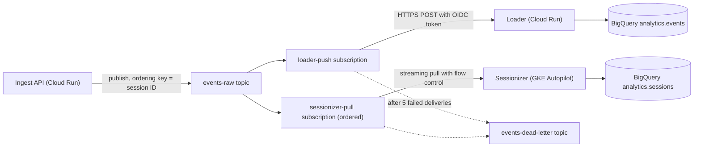

# Event-Driven PubSub Pipelines

An event-driven pipeline puts a [[Cloud PubSub|Pub/Sub]] topic between the services that produce events and the services that act on them. Producers publish and move on. Each subscription attached to the topic receives the topic's messages and lets its consumer work at its own pace, so a slow or failing consumer holds back neither ingestion nor the other subscriptions.[^pubsub-overview]

## Pipeline Shape

The diagram follows the pipeline in the [[Event Analytics Design Brief Summary]]: one topic, a push subscription for a stateless loader, and an ordered pull subscription for a stateful sessionizer.

## Pull Versus Push Delivery

| Aspect | Pull subscription | Push subscription |
| :--- | :--- | :--- |
| Who starts delivery | The subscriber client requests messages | Pub/Sub sends an HTTPS POST to an endpoint |
| Flow control | The client caps outstanding messages and bytes | Pub/Sub grows or shrinks a push window based on endpoint success |
| Acknowledgement | Explicit ack, with deadlines extended by the client library | A successful HTTP response acknowledges the message |
| Exactly-once delivery | Supported, including StreamingPull | Not supported |
| Typical consumer | Long-running workers on [[GKE Autopilot]] | Request-driven handlers on [[Cloud Run Serverless Containers|Cloud Run]] |

- **Choose Pull** when consumers need high throughput, exactly-once delivery, or tight control over how much work is in flight.[^pubsub-pull][^pubsub-exactly-once]
- **Choose Push** when the consumer is an HTTPS service that should scale with message volume. Keep the endpoint private and have the subscription attach a Google-signed OpenID Connect token for a dedicated service account that holds only the invoker role.[^pubsub-push][^pubsub-push-auth]
- **Skip the Consumer** when messages only need to land in [[BigQuery]]: a BigQuery subscription writes messages to an existing table as they arrive, with no subscriber code to run.[^pubsub-bigquery]

## Ordering Keys

Messages that share an ordering key, such as a session or account ID, arrive in publish order when they are published in the same region and the subscription has message ordering enabled. Plan for the trade-offs:[^pubsub-ordering]

- **Throughput per Key**: Publishing on any single ordering key is limited to 1 MBps, so prefer high-cardinality keys over one global key.
- **Ordering Is per Subscription**: Only subscriptions with ordering enabled preserve order. Other subscriptions on the same topic receive the same messages without that guarantee.
- **Cascading Redelivery**: Redelivering one message also redelivers every later message for that key, even ones already acknowledged, so ordered consumers must be idempotent.
- **Head-of-Line Blocking**: Unacknowledged messages for one key can delay delivery for other keys. Keep handlers fast, and note that dead-letter forwarding is best effort when combined with ordering.

## Acknowledgement, Retries, and Dead Letters

- **At-Least-Once by Default**: Every subscription type delivers at least once, with no ordering guarantee unless ordering is enabled. A message that is not acknowledged within its ack deadline (10 seconds by default, up to 600 seconds) is delivered again, so consumers must tolerate duplicates. The [[Idempotent Event Consumer and Dead-Letter Queue]] pattern makes that safe.[^pubsub-subscriptions][^pubsub-properties]
- **Retry with Backoff**: A retry policy with exponential backoff spaces out redeliveries after negative acknowledgements or expired deadlines instead of retrying immediately.[^pubsub-properties]
- **Dead-Letter Topics**: After a configurable number of delivery attempts, from 5 to 100, Pub/Sub forwards the message to a dead-letter topic, where it can be inspected and replayed without blocking the main flow.[^pubsub-dead-letter]

## Backpressure

- **Pull Consumers**: Flow control caps outstanding messages and bytes per client. When a limit is reached, the client library stops requesting messages until work drains, and the backlog waits in the subscription.[^pubsub-flow-control]
- **Push Consumers**: Pub/Sub sizes concurrent push requests with a slow-start algorithm, widening the push window on success and narrowing it on failure. A run of negative acknowledgements triggers a push backoff that pauses delivery briefly.[^pubsub-push]
- **Bound the Handler**: Cap the [[Cloud Run]] handler with a maximum instance count so a surge cannot exhaust connections to [[Cloud SQL for PostgreSQL]].[^run-max-instances]
- **Watch the Backlog**: Alert on the age of the oldest unacknowledged message, not only on message counts, because age shows directly when consumers fall behind.[^pubsub-monitoring]

## Related Notes

- [[Cloud PubSub]]
- [[Idempotent Event Consumer and Dead-Letter Queue]]
- [[Cloud Run Serverless Containers]]
- [[GKE Autopilot]]
- [[OpenTelemetry Trace Propagation Across Services]]
- [[Google Cloud Serverless Analytics Reference]]
- [[Event Analytics Design Brief Summary]]
