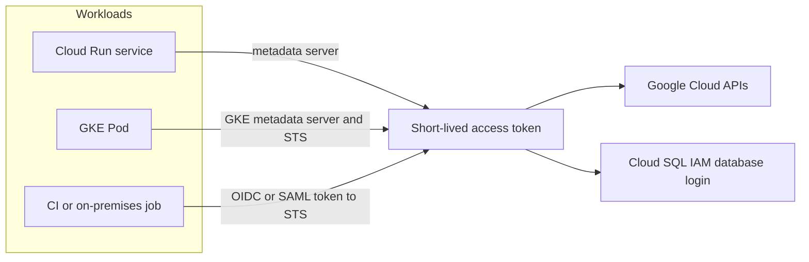

# Workload Identity Federation

A service account key is a long-lived bearer credential: anyone who copies the JSON file can act as that service account until someone notices and revokes the key. Keyless authentication removes the file. Each workload proves who it is with a credential its platform already issues, and Google Cloud trades that credential for a short-lived access token.[^iam-key-practices]

- **On Google Cloud Runtimes**: [[Cloud Run]] and similar platforms do this for you. The workload runs as an attached service account, and the metadata server issues its tokens.[^run-identity]
- **Everywhere Else**: For [[Google Kubernetes Engine]] Pods and workloads outside Google Cloud, Workload Identity Federation does the trade. The workload presents a Kubernetes ServiceAccount token, an OIDC token, or a SAML assertion to the Security Token Service, which verifies it and returns a federated token under the OAuth 2.0 token exchange specification.[^iam-wif]

## How the Exchange Works

1. **Trust**: A workload identity pool trusts an identity provider. Attribute mappings translate claims in the provider's tokens into Google Cloud attributes, and an attribute condition, written in CEL, rejects any credential whose attributes do not match.[^iam-wif]
2. **Exchange**: The workload sends its token to the Security Token Service and receives a short-lived federated token in return.[^iam-wif]
3. **Authorize**: IAM roles are granted to the federated principal directly, or the principal is allowed to impersonate a service account. Neither path involves an exported key.[^iam-wif]

## Keyless Paths by Runtime

| Runtime | Keyless mechanism | Identity that IAM sees |
| :--- | :--- | :--- |
| [[Cloud Run]] service or job | Attached service account, tokens from the metadata server | The attached service account |
| [[Google Kubernetes Engine]] Pod | Workload Identity Federation for GKE, enabled by default on [[GKE Autopilot]] | A principal for the Kubernetes ServiceAccount, or a service account it impersonates |
| CI/CD or on-premises job | Workload identity pool with an OIDC or SAML 2.0 provider | A federated principal built from mapped token attributes |
| [[Cloud SQL for PostgreSQL]] login | Automatic IAM database authentication through the Cloud SQL Auth Proxy or a language connector | An IAM database user named after the service account |

- **Cloud Run**: Give each service and job its own user-managed service account instead of the Compute Engine default account, and never point `GOOGLE_APPLICATION_CREDENTIALS` at a key file. Client libraries request tokens from the instance metadata server automatically.[^run-identity]
- **GKE**: Enabling the feature creates a fixed workload identity pool named `PROJECT_ID.svc.id.goog`. Grant roles to principals such as `principal://iam.googleapis.com/projects/PROJECT_NUMBER/locations/global/workloadIdentityPools/PROJECT_ID.svc.id.goog/subject/ns/NAMESPACE/sa/KSA_NAME`. The GKE metadata server on every node intercepts credential requests from Pods and obtains tokens for the Pod's Kubernetes ServiceAccount rather than the node's service account.[^gke-wif]
- **Deployment Pipelines**: Federate the CI/CD system's OIDC tokens and pin attribute conditions to the exact repository and branch, so the pipeline needs no long-lived deploy key.[^iam-wif-pipelines]
- **Cloud SQL for PostgreSQL**: With automatic IAM database authentication, the connector requests and refreshes one-hour OAuth 2.0 access tokens and presents them in place of a password. A service account's database user is its email without the `.gserviceaccount.com` suffix, for example `events-loader@my-project.iam`.[^sql-iam-auth]

## SPIFFE Identities for Workload-to-Workload mTLS

Federation covers calls to Google Cloud APIs. For calls between workloads, managed workload identities, which are built on SPIFFE and in Preview for GKE at the time of writing, provision X.509 credentials and trust anchors from Certificate Authority Service so services can authenticate each other over mutual TLS. A GKE workload's SPIFFE ID uses the same pool as its trust domain, in the form `spiffe://PROJECT_ID.svc.id.goog/ns/NAMESPACE/sa/KSA_NAME`. The identity a Pod presents to Google Cloud APIs and the identity it presents to its peers therefore stay aligned, and neither depends on a shared secret.[^managed-wi]

## Guardrails

- **Block Key Creation**: Enforce the `iam.managed.disableServiceAccountKeyCreation` organization policy constraint so new keys cannot be created, then find and delete the keys that already exist.[^org-policy-keys][^iam-key-practices]
- **Constrain Federation**: Write attribute conditions that pin the exact repository, branch, or workload, so a token from an unrelated user of the same identity provider cannot be exchanged.[^iam-wif]
- **One Identity per Workload**: Give each application its own single-purpose service account so audit logs stay attributable and a compromised workload cannot borrow another workload's permissions.[^iam-sa-practices]

## Related Notes

- [[Cloud Run]]
- [[Google Kubernetes Engine]]
- [[Cloud SQL for PostgreSQL]]
- [[Cloud Run Serverless Containers]]
- [[GKE Autopilot]]
- [[Production Readiness and Observability Checklist]]
- [[Event Analytics Design Brief Summary]]
