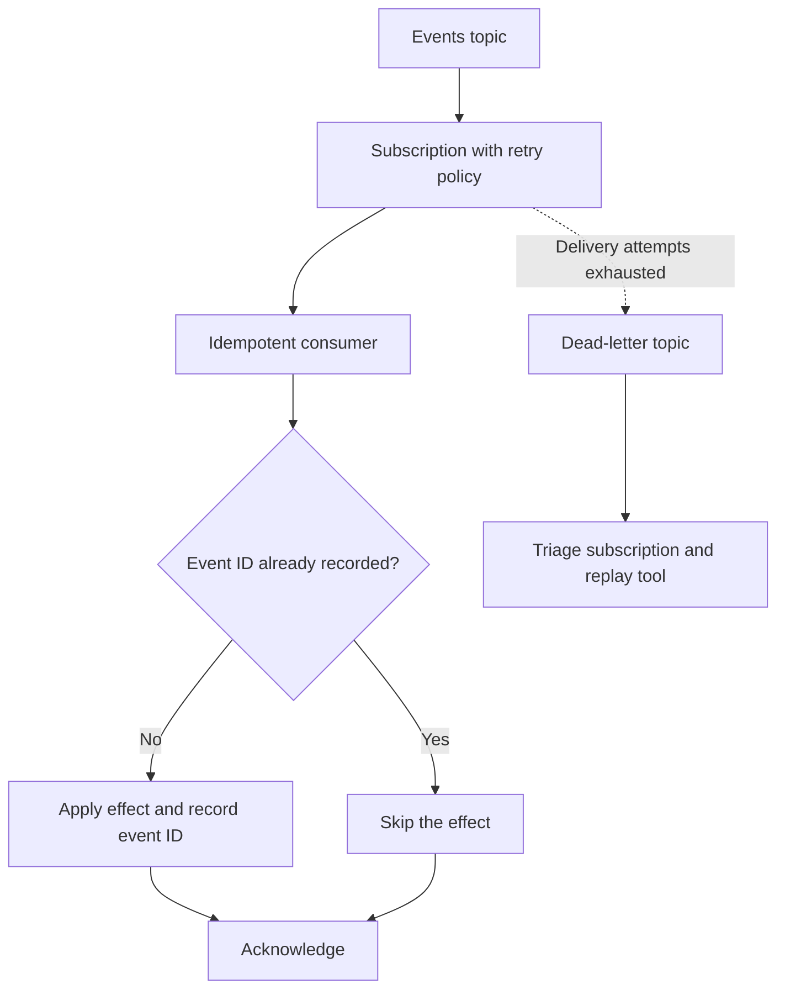

# Idempotent Event Consumer and Dead-Letter Queue

An **idempotent consumer** records a deduplication key together with the effect of a message, so a redelivered message changes nothing. A **dead-letter topic** takes messages that keep failing out of the main subscription, so one bad payload cannot stall the backlog. Together they make at-least-once delivery from [[Cloud PubSub|Pub/Sub]] safe to land in [[Cloud SQL for PostgreSQL]] or [[BigQuery]].

## Problem

- **Redelivery is normal**: Pub/Sub offers at-least-once delivery by default. A message is redelivered when it is not acknowledged before its deadline, and in rare cases even after an acknowledgment succeeded.[^pubsub-subscriptions]
- **Exactly-once delivery has a narrow scope**: It is available only on pull subscriptions and only within a single region. Push and export subscriptions do not support it, and a publisher that retries can still create several messages with different message IDs for one logical event.[^pubsub-exactly-once]
- **Poison messages block healthy ones**: A message that can never be processed is retried until it expires, which consumes consumer capacity and hides the real backlog.[^pubsub-dead-letter]

## Solution



Three rules hold the pattern together:

- **Key on the event, not the delivery**: The producer assigns an `event_id` once, before the first publish attempt, and sends it with the message. The Pub/Sub message ID is not a safe key, because publisher retries can produce more than one ID for the same event.[^pubsub-exactly-once]
- **Make it durable, then acknowledge**: The consumer acknowledges only after both the effect and the key are stored. A crash before the acknowledgment causes a redelivery, which the key check absorbs.
- **Bound the retries**: The subscription uses exponential backoff and forwards a message to a dead-letter topic after a fixed number of delivery attempts.[^pubsub-retry-policy][^pubsub-dead-letter]

## Sink Recipes

| Sink | Deduplication mechanism | Remaining gap |
| :--- | :--- | :--- |
| [[Cloud SQL for PostgreSQL]], effect and key in one database | A unique constraint on `event_id`, written in the same transaction as the business change with `INSERT ... ON CONFLICT DO NOTHING` | None. The transaction commits both or neither. |
| [[BigQuery]] append guarded by a [[Cloud SQL for PostgreSQL|Cloud SQL]] ledger | Look up `event_id` in the ledger, append the row, insert the key, then acknowledge | A crash between the append and the insert can leave a duplicate row, which readers remove by `event_id`. |
| [[BigQuery]] through a committed Storage Write API stream | Row offsets give exactly-once appends within the stream. The default stream is at-least-once.[^bq-storage-write-api] | A replay through a different stream is not detected, so `event_id` stays in the table. |
| [[BigQuery]] through a BigQuery subscription | Pub/Sub writes rows without consumer code and without exactly-once delivery, so readers deduplicate on `event_id`.[^pubsub-exactly-once] | A row that cannot be written is negatively acknowledged and can be forwarded to a dead-letter topic with an error attribute.[^pubsub-bigquery-subscriptions] |

The second row is the loader design in [[Event Analytics Design Brief Summary]]: a `processed_events` ledger with a primary key on `event_id`, and a deduplicating view for readers that need exact counts.

When the effect and the key live in the same [[Cloud SQL for PostgreSQL]] database, one transaction covers both:

```sql
BEGIN;

INSERT INTO processed_events (event_id, received_at)
VALUES (:event_id, now())
ON CONFLICT (event_id) DO NOTHING;

-- Run the business change only when the insert above affected one row.
UPDATE tenant_usage
SET event_count = event_count + 1
WHERE tenant_id = :tenant_id;

COMMIT;
```

Read-time deduplication in [[BigQuery]] keeps one row per key. The partition filter comes before the window function, so the query still satisfies [[Partition Filter Enforcement Guardrail]]:

```sql
SELECT *
FROM analytics.events
WHERE event_ts >= TIMESTAMP_SUB(CURRENT_TIMESTAMP(), INTERVAL 1 DAY)
QUALIFY ROW_NUMBER() OVER (PARTITION BY event_id ORDER BY event_ts) = 1;
```

## Dead-Letter Configuration

- **Attach it to the subscription**: A dead-letter topic is a subscription property, with a maximum number of delivery attempts between 5 and 100.[^pubsub-dead-letter]
- **Grant the forwarding roles**: The Pub/Sub service account needs permission to publish to the dead-letter topic and to acknowledge on the source subscription. Delivery attempts are counted only when these permissions are in place.[^pubsub-dead-letter]
- **Give the dead-letter topic its own subscription**: A separate subscription receives the forwarded messages for analysis and replay.[^pubsub-dead-letter]
- **Expect an approximate count**: Forwarding is best effort, so a message can arrive a few more times than the configured maximum. The idempotency key covers that gap.[^pubsub-dead-letter]
- **Back off between attempts**: Subscriptions redeliver immediately by default. An exponential backoff policy, with delays between 0 and 600 seconds, gives a failing dependency time to recover.[^pubsub-retry-policy]
- **Use the forwarding attributes**: Forwarded messages carry `CloudPubSubDeadLetterSourceSubscription` and `CloudPubSubDeadLetterSourceDeliveryCount`, which a replay tool can use to route messages back.[^pubsub-dead-letter]

The push subscription from the design brief, with five delivery attempts before forwarding:

```bash
gcloud pubsub subscriptions create loader-push \
  --topic=events-raw \
  --push-endpoint=LOADER_URL \
  --push-auth-service-account=PUSH_INVOKER_SERVICE_ACCOUNT \
  --ack-deadline=60 \
  --min-retry-delay=10s \
  --max-retry-delay=600s \
  --dead-letter-topic=events-dead-letter \
  --max-delivery-attempts=5
```

## Operational Signals

- **Backlog age**: Alert on `subscription/oldest_unacked_message_age_by_region` to catch a consumer that is falling behind.[^pubsub-monitoring]
- **Dead-letter volume**: Alert when `subscription/dead_letter_message_count` rises above zero.[^pubsub-monitoring]
- **Duplicates absorbed**: Count skipped effects in the consumer. A sudden rise usually means the acknowledgment deadline is shorter than the processing time.
- **Trace continuity**: Carry trace context in message attributes so a dead-lettered message can be tied back to the request that produced it, as described in [[OpenTelemetry Trace Propagation Across Services]].

## Trade-offs

- **Key storage grows**: Prune ledger rows once they are older than the longest window in which a message could still be redelivered or replayed.
- **Ordering multiplies duplicates**: On a subscription with ordering keys, redelivering one message also redelivers every later message for that key, even acknowledged ones.[^pubsub-ordering] An ordered consumer needs the key check more, not less.
- **External side effects are not covered**: An email or a call to another API is outside the stored effect. Pass `event_id` to the downstream service as its idempotency token.
- **A ledger adds a dependency**: Every delivery now needs the database. Cap consumer instances and pool connections so a burst of deliveries does not exhaust [[Cloud SQL for PostgreSQL]].

## Related Notes

- [[Event-Driven PubSub Pipelines]] describes the delivery modes this pattern builds on.
- [[Event Analytics Design Brief Summary]] is the source of the loader, ledger, and dead-letter settings used as examples here.
- [[Revision Traffic Splitting and Canary Rollback]] relies on idempotent handlers so work retried during a rollback is safe.
- [[Production Readiness and Observability Checklist]] turns this pattern into a launch gate.
- [[Google Cloud Serverless Analytics Reference]] shows where the consumer sits in the end-to-end flow.
