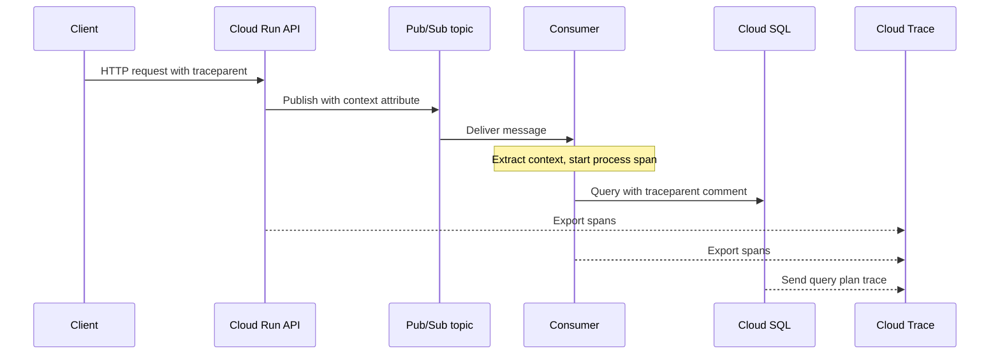

# OpenTelemetry Trace Propagation Across Services

OpenTelemetry is a vendor-neutral framework for generating and exporting traces, metrics, and logs.[^otel-docs] This pattern uses it to carry one W3C `traceparent` context from the first HTTP request through [Cloud Run](../entities/Cloud%20Run.md), across [Pub/Sub](../entities/Cloud%20PubSub.md), and into [Cloud SQL for PostgreSQL](../entities/Cloud%20SQL%20for%20PostgreSQL.md), so Cloud Trace can show the whole path of an event as one trace.[^cloud-trace-docs]

## Problem

- **Each hop keeps its own telemetry**: Without a shared trace ID, latency and errors cannot be attributed across service boundaries.
- **Asynchronous hops lose context**: HTTP instrumentation forwards headers automatically. A message broker and a database do not, unless the design carries the context for them.
- **Partial traces mislead**: A trace that ends at the publish call suggests the request finished, while the consumer may still be retrying.

## The Context

The `traceparent` header has four fields: a version, a 32-character trace ID, a 16-character parent span ID, and trace flags in which `01` means the parent sampled the span.[^cloud-trace-context]

```text
traceparent: 00-4bf92f3577b34da6a3ce929d0e0e4736-00f067aa0ba902b7-01
```

OpenTelemetry's default propagator reads and writes this header.[^otel-context-propagation] Google Cloud services that propagate trace context typically accept both `traceparent` and the older `X-Cloud-Trace-Context` header. New code should send `traceparent` and treat the older header as a fallback.[^cloud-trace-context]

## Hop-by-Hop Design



| Hop | Carrier | Design rule |
| :--- | :--- | :--- |
| Client to [Cloud Run](../entities/Cloud%20Run.md) | HTTP `traceparent` header | Server instrumentation extracts the context and starts a server span. Cloud Run also records its own request spans, sampled at no more than 0.1 requests per second for each instance.[^run-tracing] |
| [Cloud Run](../entities/Cloud%20Run.md) to [Pub/Sub](../entities/Cloud%20PubSub.md) | Message attribute | The publisher injects the context into a message attribute. Pub/Sub client libraries do this when tracing is enabled, using an attribute with the `googclient_` prefix.[^pubsub-otel-tracing] |
| [Pub/Sub](../entities/Cloud%20PubSub.md) to consumer | Message attribute | The consumer extracts the creation context and starts a process span that links to it.[^otel-messaging-spans] |
| Consumer to [Cloud SQL](../entities/Cloud%20SQL%20for%20PostgreSQL.md) | Client span and SQL comment | Database instrumentation starts a client span. Sqlcommenter adds `traceparent` to the statement as a comment, and query insights can then show the query inside the application trace.[^sql-query-insights] |
| Every hop to logs | Structured log fields | Each service writes the trace and span identifiers into its log entries so they are linked to the trace.[^trace-log-link] |

## Parent or Link Across the Queue

The messaging conventions use span links as the default way to correlate producers and consumers. A span can have only one parent, so links are the only structure that also works for batches and for several consumers of one message. When a handler processes a single message, the process span may instead use the creation context as its parent, which gives one continuous trace.[^otel-messaging-spans]

- **Single-message handlers**: Use the creation context as the parent. The trace reads top to bottom from the HTTP request to the database write.
- **Batch consumers**: Start one span for the batch and add a link for each message.
- **Redeliveries**: Each delivery attempt starts a new process span tied to the same creation context. Retries and dead-lettering in [Idempotent Event Consumer and Dead-Letter Queue](Idempotent%20Event%20Consumer%20and%20Dead-Letter%20Queue.md) then appear as repeated spans instead of disappearing.

## Sampling

- **Decide once, at the edge**: Head sampling makes the decision as early as possible, without inspecting the whole trace.[^otel-sampling] Downstream services should follow the sampled flag they receive, so a trace is either complete or absent.
- **Do not rely on platform spans alone**: Because Cloud Run limits the rate of the request spans it records, application-side sampling is what determines coverage for high-volume services.[^run-tracing]
- **Keep errors visible**: Head sampling cannot guarantee that every failing trace is kept. Use tail sampling in a collector where that matters.[^otel-sampling]

## Implementation Notes

- **One propagator everywhere**: Configure W3C trace context in every service. Mixed propagators break the chain at the first boundary.
- **Keyless export**: Exporters authenticate with the identity attached to the workload, which needs the Cloud Trace agent role.[^pubsub-otel-tracing] No key file is involved, in line with [Workload Identity Federation](../concepts/Workload%20Identity%20Federation.md).
- **Name the revision**: Add the service name and the Cloud Run revision as resource attributes so canary traffic can be compared in [Revision Traffic Splitting and Canary Rollback](Revision%20Traffic%20Splitting%20and%20Canary%20Rollback.md).
- **Keep payloads out**: Put identifiers in span attributes, never message bodies, credentials, or personal data.
- **Test the chain**: Send one synthetic request and confirm that a single trace contains the server span, the publish span, the process span, and the database client span.

## Trade-offs

- **Instrumentation coverage varies**: Sqlcommenter supports specific frameworks and drivers. Statements issued outside them carry no trace comment.[^sql-query-insights]
- **Long gaps stretch traces**: A message that waits in a backlog makes a parent-child trace very long. Links keep producer and consumer traces separate and still navigable.
- **Older services need an update**: A service that only understands `X-Cloud-Trace-Context` should be changed to prefer `traceparent`.[^cloud-trace-context]

## Related Notes

- [Event Analytics Design Brief Summary](../sources/Event%20Analytics%20Design%20Brief%20Summary.md) sets the goal this pattern meets: one trace from the client request to the warehouse write.
- [Event-Driven PubSub Pipelines](../concepts/Event-Driven%20PubSub%20Pipelines.md) describes the delivery paths that carry the context.
- [Idempotent Event Consumer and Dead-Letter Queue](Idempotent%20Event%20Consumer%20and%20Dead-Letter%20Queue.md) uses the trace to explain retries.
- [Revision Traffic Splitting and Canary Rollback](Revision%20Traffic%20Splitting%20and%20Canary%20Rollback.md) uses per-revision traces as rollout evidence.
- [Production Readiness and Observability Checklist](../synthesis/Production%20Readiness%20and%20Observability%20Checklist.md) requires one end-to-end trace before launch.
