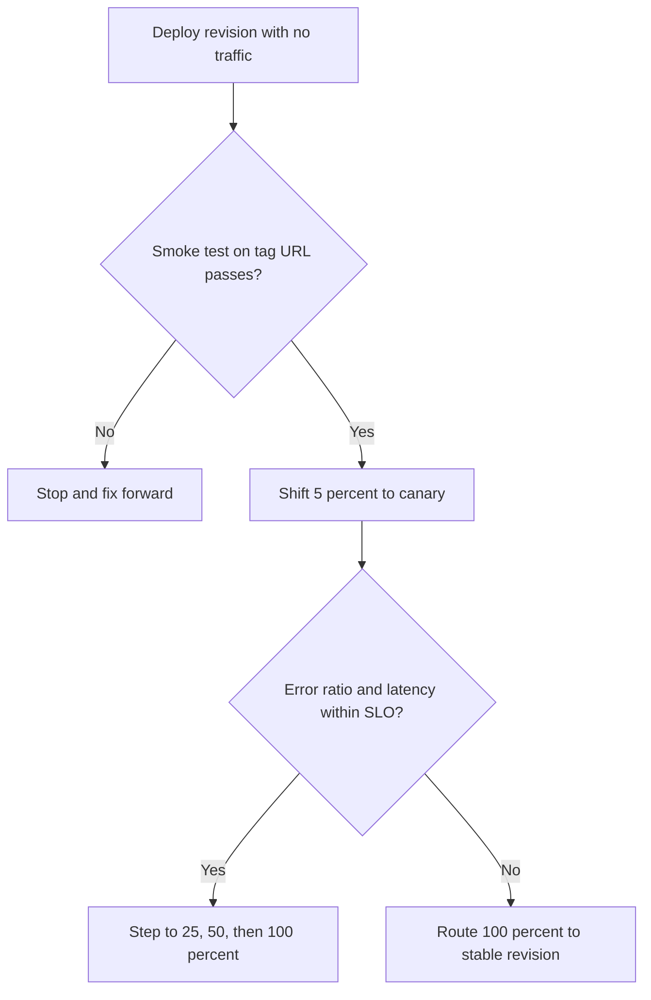

# Revision Traffic Splitting and Canary Rollback

Every deployment to [[Cloud Run]] creates a new revision. This pattern releases that revision with no traffic, shifts a small share of requests to it, and moves forward only while health signals stay inside the service-level objective. Rolling back is a routing change, not a rebuild.

## Problem

- **All-at-once releases expose every user**: A regression that reaches 100 percent of traffic immediately becomes an incident.
- **Probes prove readiness, not correctness**: Startup, liveness, and readiness probes tell Cloud Run when an instance can start, must restart, or should receive traffic.[^run-health-checks] They do not show whether the new code returns more errors or responds more slowly under real requests.
- **Slow rollbacks extend incidents**: A rollback that needs a new build and deploy takes minutes that a routing change does not.

## Solution



- **Deploy dark**: Deploy with `--no-traffic` and a tag. The tag gives the revision its own URL, so it can be tested directly without serving production requests.[^run-rollouts]
- **Shift a small share**: Assign a low percentage, for example 5 percent, to the tagged revision. Changing the split does not require a redeploy.[^run-rollouts]
- **Hold at the gate**: Keep the split for a fixed observation window and compare the canary with the stable revision. The rollout in [[Event Analytics Design Brief Summary]] holds each step for 15 minutes and watches the error rate and the 95th percentile latency of the new revision.
- **Promote in steps**: Repeat the gate at each increment until the canary serves all traffic.
- **Roll back by routing**: Send 100 percent of traffic to the previous revision by name. Requests already in flight are not dropped during the change.[^run-rollouts]

```bash
# 1. Deploy the candidate without traffic and tag it for smoke tests.
gcloud run deploy events-ingest --image IMAGE_URL --no-traffic --tag canary

# 2. Send 5 percent of requests to the tagged revision.
gcloud run services update-traffic events-ingest --to-tags canary=5

# 3a. Promote after the gate passes.
gcloud run services update-traffic events-ingest --to-tags canary=100

# 3b. Or roll back to the last known good revision.
gcloud run services update-traffic events-ingest --to-revisions STABLE_REVISION=100
```

## Health Gate

| Signal | Where it comes from | Example rollback trigger |
| :--- | :--- | :--- |
| Instance readiness | Startup and readiness probes on the revision[^run-health-checks] | The revision never becomes ready, or instances keep leaving rotation |
| Server error ratio | Request count for the `cloud_run_revision` resource, compared per revision[^run-monitoring] | The canary error ratio exceeds the stable revision by an agreed margin |
| Latency | Request latencies for the same resource[^run-monitoring] | The canary 95th percentile crosses the objective |
| Error budget | The service-level objective and its error budget in service monitoring[^slo-monitoring] | The budget is consumed faster than the agreed rate during the rollout |
| Downstream pressure | Connection counts on [[Cloud SQL for PostgreSQL]] and backlog age on [[Cloud PubSub|Pub/Sub]] | Either grows only after the traffic shift |

The margins and window lengths are team decisions derived from the service's own objective. They are not platform defaults.

## Automating the Gate

Cloud Deploy can run the same sequence as a pipeline. Its canary strategy creates one phase per percentage increment plus a final stable phase, lets Cloud Run split traffic between the old and new revisions, and can run a verify job in each phase.[^deploy-canary] Keep the manual commands above documented as the break-glass path.

## Preconditions and Trade-offs

- **Schema changes must be backward compatible**: Both revisions run at the same time against the same [[Cloud SQL for PostgreSQL]] database. Add columns first, switch readers and writers, and remove old columns in a later release.
- **Handlers must be idempotent**: A request or event retried during a rollback may be handled by either revision. [[Idempotent Event Consumer and Dead-Letter Queue]] makes that safe.
- **The split is per request**: One user can reach both revisions during a rollout, so responses must stay compatible. Session affinity changes how the split behaves and should be tested on purpose.[^run-rollouts]
- **Low traffic weakens the signal**: A 5 percent share of a few requests per minute says little. Lengthen the window or drive synthetic requests at the tag URL.
- **Traces need the revision name**: Record the `K_REVISION` environment variable as a resource attribute so canary spans can be filtered, as described in [[OpenTelemetry Trace Propagation Across Services]].

## Related Notes

- [[Cloud Run Serverless Containers]] explains revisions and request-driven scaling.
- [[Event Analytics Design Brief Summary]] is the source of the four-step rollout used as the example here.
- [[Cloud Run vs GKE Autopilot Decision Matrix]] compares this rollout model with Kubernetes rolling updates.
- [[Production Readiness and Observability Checklist]] requires a tested rollback before launch.
