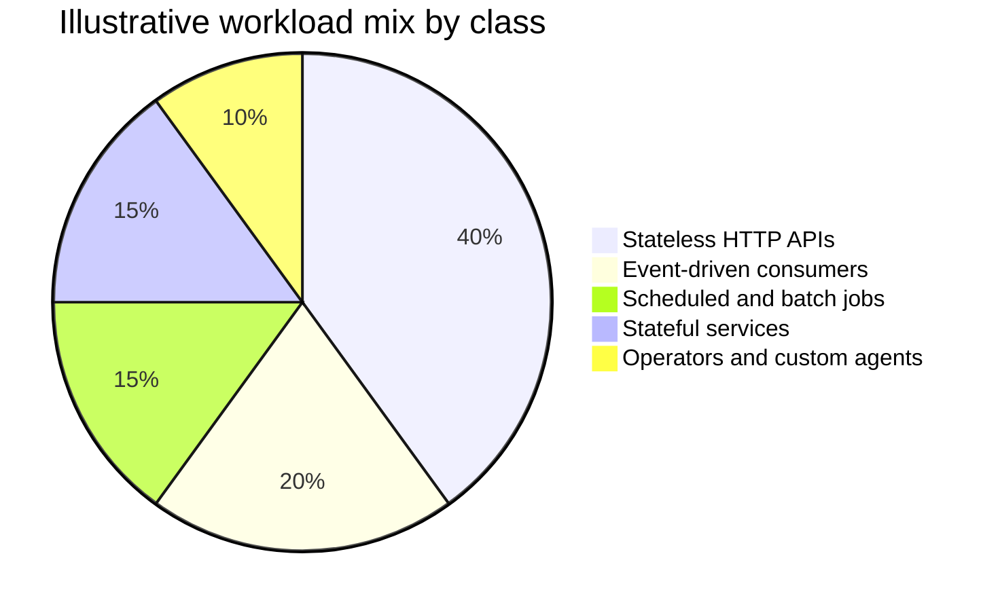

# Cloud Run vs GKE Autopilot Decision Matrix

[Cloud Run](../entities/Cloud%20Run.md) and [Google Kubernetes Engine](../entities/Google%20Kubernetes%20Engine.md) in Autopilot mode both run the same container image without node management by the team. The decision is how much of the Kubernetes API the workload needs. Cloud Run is best suited to stateless, request-driven and event-driven services, while GKE is best suited to stateful applications, complex microservices, and cases where deep control over Kubernetes is essential.[^gke-and-cloud-run]

## Decision Table

| Criterion | Lean toward [Cloud Run](../concepts/Cloud%20Run%20Serverless%20Containers.md) | Lean toward [Autopilot](../concepts/GKE%20Autopilot.md) | Related note |
| :--- | :--- | :--- | :--- |
| Infrastructure to operate | No cluster to create or manage[^run-overview] | Google manages nodes, while the team stays responsible for the core Kubernetes aspects[^gke-autopilot-overview][^gke-and-cloud-run] | [Autopilot concept](../concepts/GKE%20Autopilot.md) |
| Workload shape | Stateless services, functions, and jobs that run to completion[^gke-and-cloud-run] | Stateful applications and complex microservices with specific resource needs[^gke-and-cloud-run] | [Reference architecture](Google%20Cloud%20Serverless%20Analytics%20Reference.md) |
| Kubernetes API | Not needed by the workload | Operators, custom resources, or existing manifests are part of the design | [GKE](../entities/Google%20Kubernetes%20Engine.md) |
| Scaling | Request-driven, down to zero instances when idle[^run-autoscaling] | Replica counts follow CPU, memory, or custom metrics | [Serverless containers](../concepts/Cloud%20Run%20Serverless%20Containers.md) |
| Request shape | HTTP, gRPC, or WebSocket requests that finish within the timeout, 5 minutes by default and 60 at most[^run-overview][^run-request-timeout] | Custom TCP or UDP protocols, or work that outlives a request timeout | [Cloud Run](../entities/Cloud%20Run.md) |
| Event consumption | Push delivery to a service, or a worker pool for always-on pull consumers[^run-overview] | Consumers that also need Kubernetes scheduling, storage, or operators | [Pub/Sub pipelines](../concepts/Event-Driven%20PubSub%20Pipelines.md) |
| State | State is kept in [Cloud SQL](../entities/Cloud%20SQL%20for%20PostgreSQL.md) or [BigQuery](../entities/BigQuery.md) | Pods need stable identities or a persistent volume for each replica | [Idempotent consumer](../patterns/Idempotent%20Event%20Consumer%20and%20Dead-Letter%20Queue.md) |
| Rollouts | Built-in revision traffic splitting[^run-rollouts] | Rolling updates, with canaries added through a gateway or delivery pipeline | [Canary rollback](../patterns/Revision%20Traffic%20Splitting%20and%20Canary%20Rollback.md) |
| Identity | A service account attached to each service[^run-service-identity] | Kubernetes ServiceAccounts referenced directly in IAM policies[^gke-workload-identity] | [Keyless identity](../concepts/Workload%20Identity%20Federation.md) |
| Tracing | Not a differentiator: OpenTelemetry spans are exported the same way | Not a differentiator: OpenTelemetry spans are exported the same way | [Trace propagation](../patterns/OpenTelemetry%20Trace%20Propagation%20Across%20Services.md) |

## Illustrative Workload Mix

The chart below is a planning example for a platform team that sorts its container workloads by class. The percentages are illustrative, not measured data. Replace them with your own inventory before using the chart in a review.

| Workload class | Usual home | Reason |
| :--- | :--- | :--- |
| Stateless HTTP APIs | [Cloud Run](../concepts/Cloud%20Run%20Serverless%20Containers.md) service | Request-driven scaling and revision traffic splitting cover the need |
| Event-driven consumers | [Cloud Run](../concepts/Cloud%20Run%20Serverless%20Containers.md) service or worker pool | Push and pull consumers of [Pub/Sub](../entities/Cloud%20PubSub.md) run without a cluster |
| Scheduled and batch jobs | [Cloud Run](../concepts/Cloud%20Run%20Serverless%20Containers.md) job | The task runs to completion and then releases its instances |
| Stateful services | [Autopilot](../concepts/GKE%20Autopilot.md) | Stable pod identity and persistent volumes are Kubernetes features |
| Operators and custom agents | [Autopilot](../concepts/GKE%20Autopilot.md) | Custom resources and controllers require the Kubernetes API |

In this example, the first three classes, 75 percent of workloads, lean toward Cloud Run and the remaining 25 percent lean toward Autopilot.

## Applied to the Design Brief

[Event Analytics Design Brief Summary](../sources/Event%20Analytics%20Design%20Brief%20Summary.md) places three components with the same criteria:

| Component | Runtime | Deciding factors |
| :--- | :--- | :--- |
| Ingest API | [Cloud Run](../entities/Cloud%20Run.md) | Stateless, request-driven, and bursty, with scaling to zero overnight |
| Loader | [Cloud Run](../entities/Cloud%20Run.md) | Stateless, one push request for each message from [Pub/Sub](../entities/Cloud%20PubSub.md) |
| Sessionizer | [GKE](../entities/Google%20Kubernetes%20Engine.md) in [Autopilot](../concepts/GKE%20Autopilot.md) mode | In-memory session state, a long-lived streaming pull connection, and scaling on backlog |

The brief leaves one question open: Cloud Run worker pools, which handle always-on pull workloads, were not evaluated for the sessionizer.[^run-overview] If they meet its state and scaling needs, that placement should be revisited.

## Decision Rules

- **Start with the simpler runtime**: Place a new stateless workload on Cloud Run and move it only when it needs something Cloud Run does not offer for that workload shape. The same image runs on both platforms, and the Cloud Run Admin API v1 is designed to be compatible with the Kubernetes API, which keeps a later move small.[^gke-and-cloud-run]
- **Treat Kubernetes features as hard requirements**: Custom resources, operators, per-replica persistent volumes, and non-HTTP protocols point to Autopilot regardless of team preference.
- **Use both when the system has both shapes**: Running some workloads on each platform is a supported strategy.[^gke-and-cloud-run] [Google Cloud Serverless Analytics Reference](Google%20Cloud%20Serverless%20Analytics%20Reference.md) does exactly that, with ingestion on Cloud Run and stateful processing on Autopilot.
- **Keep the cross-cutting controls identical**: Identity, tracing, and idempotent event handling should not depend on the runtime. [Production Readiness and Observability Checklist](Production%20Readiness%20and%20Observability%20Checklist.md) applies to both.
- **Revisit when the shape changes**: A Cloud Run service that has grown always-on instances and several sidecars, or a Deployment that is one stateless container scaled by request load, is a sign the workload sits on the wrong side of the table.

## Related Notes

- [Cloud Run Serverless Containers](../concepts/Cloud%20Run%20Serverless%20Containers.md) and [GKE Autopilot](../concepts/GKE%20Autopilot.md) describe each runtime on its own terms.
- [Revision Traffic Splitting and Canary Rollback](../patterns/Revision%20Traffic%20Splitting%20and%20Canary%20Rollback.md) details the Cloud Run rollout model referenced in the table.
- [Workload Identity Federation](../concepts/Workload%20Identity%20Federation.md) covers keyless identity for both runtimes.
