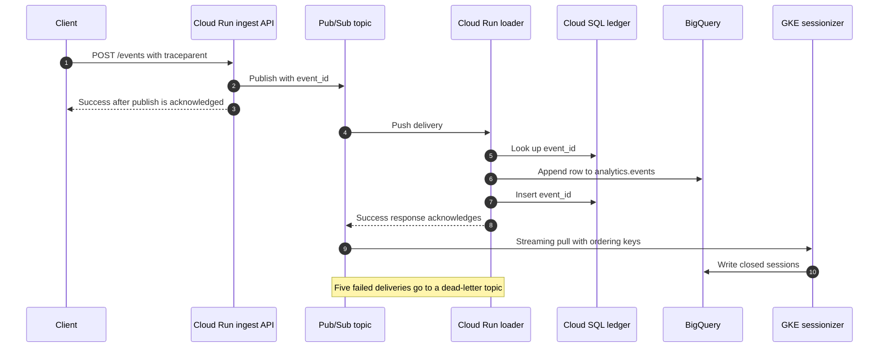

# Google Cloud Serverless Analytics Reference

This synthesis connects stateless ingestion on [[Cloud Run]], asynchronous delivery through [[Cloud PubSub|Pub/Sub]], stateful processing on [[Google Kubernetes Engine]], a deduplication ledger in [[Cloud SQL for PostgreSQL]], and partitioned analytics in [[BigQuery]] into one composable reference pattern.[^gcp-arch-center] It generalizes the platform described in [[Event Analytics Design Brief Summary]] and the table rules in [[BigQuery Governance Notes Summary]].

## End-to-End Sequence

## Component Roles

| Layer | Service | Role in the flow | Governing notes |
| :--- | :--- | :--- | :--- |
| Ingestion edge | [[Cloud Run]] | Validates each event, publishes it, and reports success only after the publish is acknowledged | [[Cloud Run Serverless Containers|Serverless containers]], [[Revision Traffic Splitting and Canary Rollback|Canary rollback]] |
| Event backbone | [[Cloud PubSub|Pub/Sub]] | Buffers events and delivers them at least once to a push and a pull subscription[^pubsub-subscriptions] | [[Event-Driven PubSub Pipelines|Pub/Sub pipelines]], [[Idempotent Event Consumer and Dead-Letter Queue|Idempotent consumer]] |
| Stateless loading | [[Cloud Run]] | Turns each pushed message into one appended row | [[Idempotent Event Consumer and Dead-Letter Queue|Idempotent consumer]], [[OpenTelemetry Trace Propagation Across Services|Trace propagation]] |
| Stateful processing | [[Google Kubernetes Engine]] | Holds open sessions in memory and scales on backlog, on Autopilot | [[GKE Autopilot]], [[Cloud Run vs GKE Autopilot Decision Matrix|Decision matrix]] |
| Deduplication ledger | [[Cloud SQL for PostgreSQL]] | Records each processed `event_id` under a primary key | [[Idempotent Event Consumer and Dead-Letter Queue|Idempotent consumer]], [[Workload Identity Federation|Keyless identity]] |
| Analytics | [[BigQuery]] | Stores events in a table partitioned by day and clustered by tenant and event type[^bq-partitioned-tables] | [[BigQuery Partitioning and Clustering|Partitioning and clustering]], [[Partition Filter Enforcement Guardrail|Filter guardrail]] |

## Design Decisions

- **Success means published**: The ingestion service validates, publishes, and only then answers the client. Slow or failing downstream work never holds a client connection open, and an accepted event no longer depends on the ingest instance.
- **One topic, two delivery modes**: A push subscription drives the stateless loader, and a pull subscription with ordering keys feeds the stateful consumer. [[Event-Driven PubSub Pipelines]] explains the choice.
- **Each workload on the runtime that fits it**: Stateless, request-driven services suit Cloud Run. Stateful applications and workloads that need deep control over Kubernetes suit GKE.[^gke-and-cloud-run] [[Cloud Run vs GKE Autopilot Decision Matrix]] gives the criteria.
- **Idempotency instead of exactly-once**: Delivery is at least once, so the loader follows [[Idempotent Event Consumer and Dead-Letter Queue]] and the events table keeps `event_id` for read-time deduplication.
- **No stored credentials**: Cloud Run services use their attached identity, GKE pods use Workload Identity Federation for GKE, and the loader signs in to PostgreSQL with IAM database authentication. See [[Workload Identity Federation]].
- **Partitioned by default**: Event tables follow [[BigQuery Partitioning and Clustering]], and [[Partition Filter Enforcement Guardrail]] rejects queries that cannot prune. This replaces the layout recorded in [[Legacy Unpartitioned Daily Batch Table]].
- **One trace per event**: The `traceparent` context travels in message attributes from the HTTP request to the warehouse write, following [[OpenTelemetry Trace Propagation Across Services]].

## Alternative Considered

A BigQuery subscription can write messages straight to a table with no consumer code.[^pubsub-bigquery-subscriptions] The design brief set it aside because its loader also validates and reshapes payloads. It remains the simpler choice when messages can land unchanged.

## Architectural Composition

- **Stateless edge and ingestion**: Deploy bursty HTTP APIs and webhook receivers on [[Cloud Run Serverless Containers]] so capacity follows demand, and release them with [[Revision Traffic Splitting and Canary Rollback]].
- **Asynchronous backbone**: Use the delivery modes in [[Event-Driven PubSub Pipelines]] to separate ingestion from processing and to absorb bursts.
- **Stateful and operator-driven services**: Run long-lived Kubernetes workloads, custom controllers, and multi-container pods on [[GKE Autopilot]].
- **Analytical storage layout**: Land telemetry in tables configured with [[BigQuery Partitioning and Clustering]] and validate scan efficiency with [[BigQuery Partition Pruning Check]].

## Operating the Reference

[[Production Readiness and Observability Checklist]] turns the decisions above into launch gates: keyless identity, an end-to-end trace, a tested rollback, duplicate-safe consumers, and bounded analytical scans.

## Source Context

- [[Event Analytics Design Brief Summary]] supplies the components, targets, and runtime decisions.
- [[BigQuery Governance Notes Summary]] supplies the table layout, scan, and access rules.
