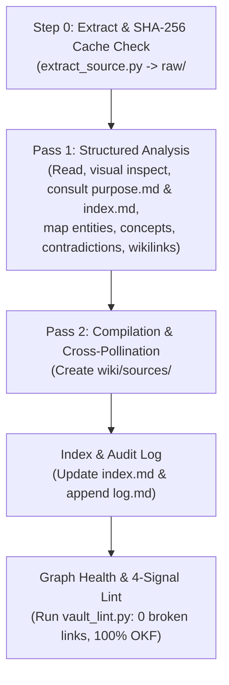

# Knowledge Compiler Operational Ingestion Protocol

When an ingest operation is triggered (via `/ingest`, `/ingest raw`, or `/ingest <target>`):

---

## ⚡ Two-Step Ingestion & Compilation Pipeline



### 1. Step 0: Locate Vault & Extract Source (with SHA-256 Caching)
- Auto-detect the Knowledge Vault root by searching upward from CWD for `GEMINI.md`, `raw/`, or `wiki/`, or fallback to `$OBSIDIAN_VAULT_PATH` or `~/ObsidianVault`.
- Execute extraction via the helper script with SHA-256 hash checks (`.ingest_cache.json`):
  ```bash
  uv run --with python-pptx --with openpyxl python <plugin_dir>/skills/ingest/scripts/extract_source.py [target]
  ```
- **Slide Decks (.pptx)**: Extract text, tables, and speaker notes into `raw/<Title>.md`. Unpack all embedded images into `raw/assets/<Title>/`.

### 2. Pass 1: Structured Analysis & Cross-Reference Mapping
- **Multimodal Visual Inspection**: Visually inspect extracted raster images using multimodal vision (`view_file`) to capture architectural diagrams, UI mockups, and charts not represented in raw text.
- **Context Grounding**: Review `purpose.md` and `index.md` to identify active customer engagements, architectural themes, and related prior notes.
- **Structured Blueprint**: Draft intermediate mapping of new entities, concepts, new claims, contradictions, and exact wikilinks.

### 3. Pass 2: Compilation, Cross-Pollination & OKF Generation
- Author `wiki/sources/<Title>.md` with OKF v0.2 YAML frontmatter (`type: source-summary`, `source_sha256: ...`).
- Include: Executive summary, deep-dive section breakdowns, structural comparison tables, and Mermaid architecture diagrams.
- Identify and enrich new/existing entity dossiers (`wiki/entities/`) and architectural concept deep-dives (`wiki/concepts/`).
- Explicitly resolve or flag contradictions between new and prior materials.
- In CLI chat output, output clean ASCII/Unicode text box diagrams alongside Mermaid references.

### 4. Step 3: Update Master Index & Log
- Update `index.md` with new entries and concise one-line summaries.
- Prepend chronological audit entry to `log.md` with format:
  `## [YYYY-MM-DD] ingest | <Source Title>`

### 5. Step 4: Run Vault Integrity & Graph Linter
- Execute the graph integrity linter:
  ```bash
  python3 scripts/vault_lint.py <vault_path>
  ```
- Verify: 0 broken links, 0 orphan notes, 0 unindexed notes, 100% OKF compliance, and review 4-signal graph insights.

